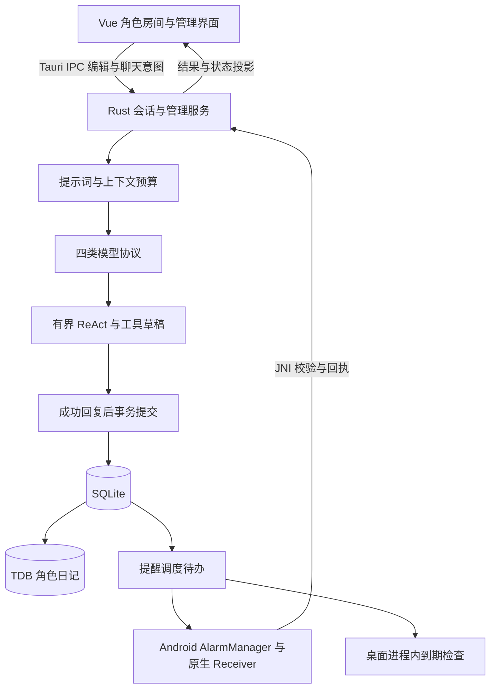

<div align="center">

<h1>PeroperoChat</h1>

<p>以角色陪伴空间为中心的 AI 聊天应用，基于 Vue 3、Tauri 2 与 Rust。</p>


</div>

当前版本：**1.4.5**。提供独立陪伴与 infOS 远程客户端两种模式，包含 Pero、Nana 两位内置角色及自定义角色支持。

## 模式与定位

- **独立模式**：参考 infOS 的职责划分，运行自己的精简 ReAct、角色、提示词、对话与日记。无需连接 infOS，数据与 infOS 不互通。调用在线模型时，所需上下文仍会发送给用户配置的模型服务；使用本地模型服务则取决于该服务的部署方式。
- **infOS 客户端**：入口已开放，从房间菜单的「infOS 客户端」或设置的「运行模式与远程连接」进入，使用设备配对或访问凭据连接远程 infOS。采用角色首页、会话、任务、资料、管理五栏布局，通知与审批从页头进入；默认恢复上次会话及其角色。聊天、工作模式、任务与记忆以服务端为权威，显示偏好、草稿和阅读位置按连接保存在本机 Rust 分区。Android 可主动开启原生常驻通知接收；厂商级系统推送、子应用和内置浏览器不在当前范围内，真实连接与手机端验收仍待完成。

## 当前能力

### 角色陪伴与界面

- 独立模式采用「轻透日常」房间 UI，统一聊天、衣柜、抽屉与设置的玻璃材质；首页可随时切换通用 Pio Live2D 与角色静态立绘／CG，选择由 Rust 保存，重启后恢复。静态模式暂停 Pio 绘制，不影响对话、状态或台词。
- 角色管理支持选择立绘、CG 排版与房间背景；内置 Pero 使用透明 SVG，Nana 使用透明 PNG，旧默认 CG 卡片自动迁移，自定义素材保留。立绘适度放大，显示与主题可调整配色、玻璃透明度、立绘大小和轻量动效，详见 [独立模式 UI 实装说明](docs/STANDALONE_UI_IMPLEMENTATION.md)。
- 对话面板支持收起、半展开与完整阅读，提供流式正文、思考内容、图片附件、重新生成、取消和删除。
- 衣柜展示现有服装贴图的细节缩略，完整上身效果由主 Live2D 模型展示；日记、提醒和角色资料使用独立抽屉。
- 设置、角色管理及既有页面共用主题与导航；服务商按实际 API 域名、模型按模型 ID 自适应显示本地品牌图标。
- 轻量点按反馈、选中动画和展开过渡支持系统“减少动画”偏好，不使用 emoji 充当界面图标。
- 家庭群聊采用小客厅界面、成员头像与角色色气泡；成员抽屉可选择参与者并调整回应顺序，保存后生效。支持思考内容、整轮停止、消息复制与删除，以及阅读历史时暂停自动跟随。其他空间保留群聊与小游戏，旧话题入口已移除。
- 远程客户端提供标准浅色／暗色／跟随系统、八组配色、Pero／Nana 独立 CG，以及自定义角色的本机 CG 与 JSON 样式包导入。会话中大图默认收起；任意 CSS、脚本及外部资源不会随角色包加载。详见 [远程 UI 实装说明](docs/REMOTE_UI_IMPLEMENTATION.md)。
- 房间首页新增独立的「前往 infOS」切换卡，远程首页提供返回独立空间的入口，继续使用原生模式隔离与至少两秒的过渡动画。
- 展开对话时暂停 Pio 绘制，人物使用合成位移／缩放；取消面板高度与大面积背景模糊动画。聊天首次只挂载最近 24 条，历史可继续加载；正文渲染有界缓存，输入、滚动与远程流帧按显示帧合并。

### infOS 客户端接入

- 支持原生相机扫描 infOS「局域网与设备」的配对二维码，也可粘贴其配对链接。Rust 校验地址、路径及一次性配对码；扫码只填表，HTTP 仍需明确勾选允许，配对码不写入日志或 Web 存储。
- 角色状态按 `agentId + threadId` 请求和缓存，返回值也核对会话身份。
- 聊天提交到 `/api/chat/queue/:threadId`，支持排队期间继续输入、立即提交、编辑、取消、暂停／继续和调整顺序；流式内容由 Gateway Surface 显示，轮询补偿当前队列与正在生成的投影。此功能需要支持队列接口的新版 infOS。
- 消息提交使用持久 UUID；确认入队后清空对应草稿，断线时按服务端队列或持久对话的队列身份核对，不按相同正文猜测，也不自动重复发送。
- Windows 使用 DPAPI，Android 使用 Keystore，iOS 接入本设备 Keychain，均不降级到明文凭据。iOS 分支和扫码链路尚需对应平台真机验收。
- 连接页区分在线通知、Android 原生后台接收与系统推送。原生常驻连接需要用户主动开启并遵循系统后台限制；厂商级系统推送尚未接入。
- 远程模式新增「管理与工作台」：配置与模型/服务商、角色与提示词发布、资料管理、会话模型/工具/消息操作、文件编辑与终端、据点群聊、调度、设备接入、维护与数据重置均提供入口。业务逻辑继续由 infOS 执行，敏感配置不进入手机投影缓存；详见 [远程管理接入记录](docs/REMOTE_MANAGEMENT_IMPLEMENTATION.md)。
- 远程对话采用一期设计的独立气泡、思考、工具轨迹、审批和折叠队列，接入稳定块与原文尾部的流式阅读、代码高亮、KaTeX、Mermaid 和隔离 HTML／SVG。媒体可在消息内浏览并放大；文档使用小窗进入独立阅读面板。
- 远程文件支持原件流式保存（单文件上限 2 GiB）、下载进度与取消；PDF 分页、MD 富文本、HTML 会话资源预览、DOC／DOCX 等正文速览、电子表格和 ZIP 目录均有入口。格式能力与预览上限见 [远程文件说明](docs/REMOTE_FILES.md)，一期改动与尚未验证的范围见 [实装记录](docs/CHAT_PHASE_ONE_IMPLEMENTATION.md)。

### 模型连接与参数

支持四类 API：**OpenAI Chat Completions、OpenAI Responses、Anthropic Messages、Google Gemini**，提供服务商预设、自定义地址、模型列表查询，以及协议对应的流式与工具调用处理。

设置界面可编辑思考强度、Temperature、Top P、输出额度、上下文窗口、历史轮次和流式开关。后端另支持思考方言、自定义请求头、扩展请求体、可选字段禁用及工具循环限制；这些高级字段尚未全部提供界面编辑入口，保存普通设置会保留未编辑字段。具体参数是否有效取决于所选模型和服务商，不保证所有模型接受全部档位。

### 精简 ReAct、提示词与日记

独立模式提供五个小工具：

| 工具 | 用途 |
| --- | --- |
| `write_diary` | 写入或修订当前角色的日记 |
| `query_diary` | 按关键词和日期查询日记 |
| `update_character` | 在同一个工具中更新角色状态与互动台词 |
| `query_reminders` | 查询当前角色提醒与设备时间 |
| `manage_reminder` | 创建、修改或取消提醒 |

日记使用 **TriviumDB（TDB）**，按角色独立保存，采用日期和文本检索，**不使用 Embedding 或向量检索**。不再要求一次模型回复同时夹带记忆提炼、状态与台词控制标签；写入工具先产生草稿，在最终回复成功持久化后提交，失败、停止或冲突会丢弃未提交草稿。

Rust 提示词框架支持区块、白名单变量、历史预算、草稿、发布、预览与回滚；目前已提供管理接口，专用提示词工作区编辑界面尚未提供。内置人设、用户资料与角色日记由后端统一编译进上下文。

### 提醒、备份与数据管理

- 提醒支持一次、每天、每周及重复截止时间，管理界面提供查询、编辑、取消与系统权限状态。
- **Android** 已接入 `AlarmManager`、原生 Receiver 与 JNI/Rust 核心，支持系统登记、到期通知、重复续排及开机解锁后的恢复。未获精确提醒权限时会降级；系统强制停止、通知权限和厂商后台限制仍会影响运行。该链路尚未经过安卓真机验收。
- **Android 远程后台接收**：连接设置可开启独立原生进程的通知服务，不加载聊天界面，不依赖 Google 服务或额外推送应用。沿用 infOS Gateway 的当前角色持久通知与未读补发，提供断线重连、展示去重、通知点击收件箱跳转和模式隔离。默认关闭，受系统后台策略影响；Android 构建及真机验收尚未进行。服务端后续接线要点见 [安卓远程通知](docs/ANDROID_REMOTE_NOTIFICATIONS.md)。
- **桌面端** 在应用进程运行时由 Rust 每 15 秒检查到期提醒；不提供进程退出后的系统唤醒。**iOS** 尚未接入与安卓等价的后台调度方案。
- SQLite 保存配置、角色、对话、日记恢复镜像和提醒事务；TDB 同步失败保留恢复任务。删除、重新生成和设置写入由 Rust 校验并提交，前端只维护表单草稿与显示状态。
- JSON 备份包含配置、角色、日记、提醒与对话，支持导出、恢复及旧数据迁移。恢复和重置会覆盖当前数据，操作前请保存备份。

## 架构



前端不直接请求 LLM、不执行工具，也不承担提示词编译、日记提炼、循环提醒计算等业务规则。界面图标识别、搜索列表过滤和动画属于展示逻辑。

详见 [独立模式架构](docs/STANDALONE_ARCHITECTURE.md)、[陪伴空间界面](docs/COMPANION_ROOM_UI.md)、[安卓系统提醒](docs/ANDROID_REMINDERS.md)。

双模式的运行隔离、关闭状态通知、远程功能范围与实装阶段见 [双模式与 infOS 远程客户端规划](docs/DUAL_MODE_AND_REMOTE_CLIENT_PLAN.md)。该文档区分历史规划、当前源码实现与尚待验收的范围。

当前原生控制、远程 IPC、前端 Store、凭据保护与未完成边界见 [双模式逻辑层实装记录](docs/REMOTE_CLIENT_LOGIC.md)。独立模式 IPC 必须携带原生运行令牌，统一通过 `localInvoke`／`localChat` 调用；远程接口使用单独的 `remoteClient`，不会复用独立角色或日记 Store。源码已适配新版 infOS 的设备配对、重新授权、Gateway 补发、输入席位与通知回执。模式交接、数据恢复、离线及授权失效均提供对应界面，入口已开放；尚待真实连接及安卓验收。

## 开发与运行

环境要求：**Node.js 20+、pnpm 9、Rust stable**，以及当前系统所需的 Tauri 开发依赖。安卓开发另需 Java、Android SDK 与 NDK；iOS 开发需要 macOS 与 Xcode。当前发布工作流使用 Java 17、Android SDK 36 和 NDK r26c。

```bash
git clone https://github.com/YoKONCy/PeroperoChat.git
cd PeroperoChat
pnpm install --frozen-lockfile

# 启动桌面完整应用，包含 Vite 与 Tauri/Rust
pnpm desktop

# Android 真机或模拟器调试
pnpm android
```

`pnpm dev` 仅启动前端开发服务，普通浏览器不具备独立模式所需的 Tauri IPC。仓库已经包含带自定义提醒桥接的 `src-tauri/gen/android`，不要直接重新初始化覆盖原生工程。iOS 工程需要在对应开发环境另行初始化，不能将安卓发布结果视为 iOS 已验收。

### 测试

```bash
# 前端传输、消息展示、品牌识别及 Vue 组件/模板校验
pnpm test

# Rust 后端测试
cargo test --manifest-path src-tauri/Cargo.toml
```

1.3.4 提交前，本地前端 **35 项**、Rust 后端 **52 项**测试通过。Vue 校验在内存中解析组件脚本与模板，不生成应用构建产物；Rust 网络测试使用本地模拟服务。未执行本地生产构建、安卓/iOS 打包、真实模型联调或安卓真机验收，这些测试也不代替视觉和端到端验收。

1.4.0 发布前按本轮授权执行前端与 Rust 后端测试：前端 **50 项**、后端 **69 项**全部通过，ESLint 检查通过。前端包含全部 Vue 组件与模板的内存校验，未生成应用构建产物；未执行本地应用构建、Tauri 启动、安卓/iOS 打包或真实 infOS 联调。发布工作流另通过 YAML 与全部 Bash 脚本的语法检查。历史阶段记录见 [双模式实装记录](docs/REMOTE_CLIENT_LOGIC.md)，真实连接、视觉端到端与安卓真机验收仍待完成。

1.4.1 前端 **55 项**、Rust 后端 **72 项**及 ESLint 全部通过，测试与修改范围见 [版本实装记录](docs/V1_4_1_IMPLEMENTATION.md)。性能改动尚未在用户手机上采样帧率，不将源码优化等同于已完成真机性能验收。

1.4.2 整理了 Android 远程后台接收适配、房间时段背景、本地气泡与表单控件，见 [版本实装记录](docs/V1_4_2_IMPLEMENTATION.md)。本次发布整理仅核对源码差异与版本元数据，未重新运行测试、构建、打包或启动程序；历史阶段的 Rust 验证和仍待真机验收的边界见对应文档。

1.4.3 为本地单聊和家庭群聊增加可折叠的工具调用时间线，随消息保存，支持旧调用记录回填及备份恢复，见 [版本实装记录](docs/V1_4_3_IMPLEMENTATION.md)。补充了 Rust 回归用例，但本轮未运行测试、构建或启动验收。

1.4.4 扩展远程管理、会话操作、资料编辑、工作台与据点群聊，接入原件流式保存和常用文件预览，并统一文件浏览界面。本次发布前运行 `pnpm test`：前端 **73 项全部通过**；此前实装阶段 Rust **99 项全部通过**，本次未重复运行后端测试。未执行本地构建、Tauri 启动或移动端打包／真机验收。范围与限制见 [远程管理接入记录](docs/REMOTE_MANAGEMENT_IMPLEMENTATION.md) 和 [远程文件说明](docs/REMOTE_FILES.md)。

1.4.5 对齐远程消息编辑、回滚和重新生成，补充模型／思考强度快捷配置与管理组件分层，落实对话一期视觉及流式富文本渲染，并增加消息内媒体、文档小窗与独立阅读入口。发布前按用户授权运行前端测试 **86 项**、Rust 后端测试 **103 项**，全部通过；前端包含全部 Vue 组件与模板的内存校验。未执行本地应用构建、Tauri 启动、移动端打包或真实 infOS／真机端到端验收；新增格式的实际显示效果和性能仍需联调。详情见 [一期实装记录](docs/CHAT_PHASE_ONE_IMPLEMENTATION.md) 和 [远程文件说明](docs/REMOTE_FILES.md)。

### 发布

版本同时维护在 `package.json`、`src-tauri/Cargo.toml`、`src-tauri/Cargo.lock` 与 `src-tauri/tauri.conf.json`。Android 的版本由 Tauri 生成到忽略跟踪的 `tauri.properties`，不手动修改生成文件。

推送 `v<版本号>` tag 会触发 GitHub Actions 的安卓 ARM64 APK 打包及 GitHub Release。从 1.4.0 起使用仓库 Secrets 中的固定发布密钥，缺失时直接失败，不再在 runner 上临时生成 debug 密钥。发布前核对实际 APK 证书与固定证书，后续版本还会比对上一版的公开指纹，避免无意更换签名。详见 [Android 签名与覆盖更新](docs/ANDROID_SIGNING.md)。

旧 CI 每次生成不同的 debug 密钥，若原私钥未保留，旧 APK 无法通过新签名直接覆盖更新。请先在旧应用导出数据备份，再卸载旧包、安装 1.4.0 并恢复备份；远程连接需重新配对。固定发布密钥保持不变后，后续版本可以正常覆盖升级。

## 许可

项目许可标记为 GPL-3.0。Live2D 模型及角色素材的权利归相应作者；模型与服务商品牌图标的来源和 MIT 许可见 [图标来源](public/model-brands/SOURCES.md)。AI 生成内容可能不准确，请自行判断。
