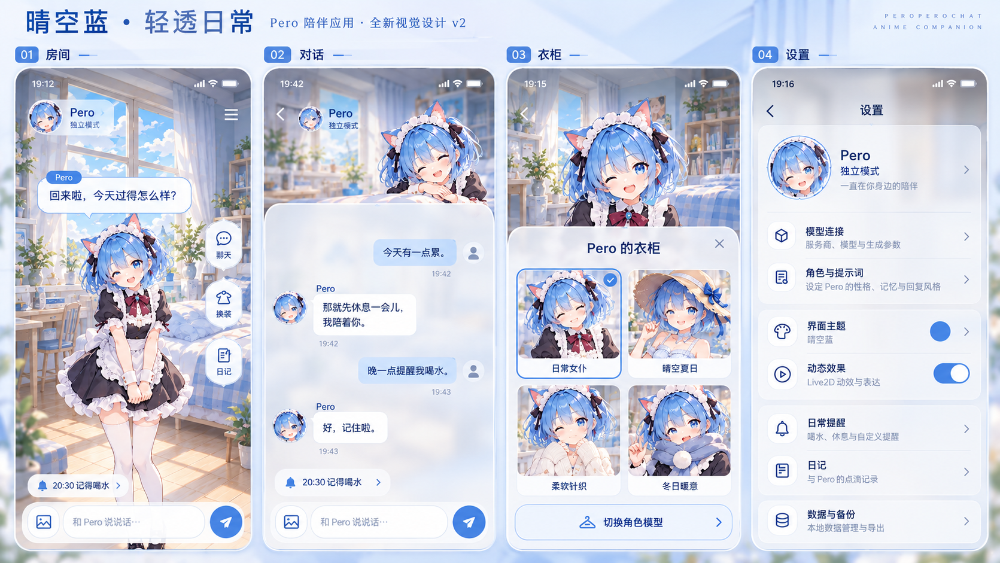
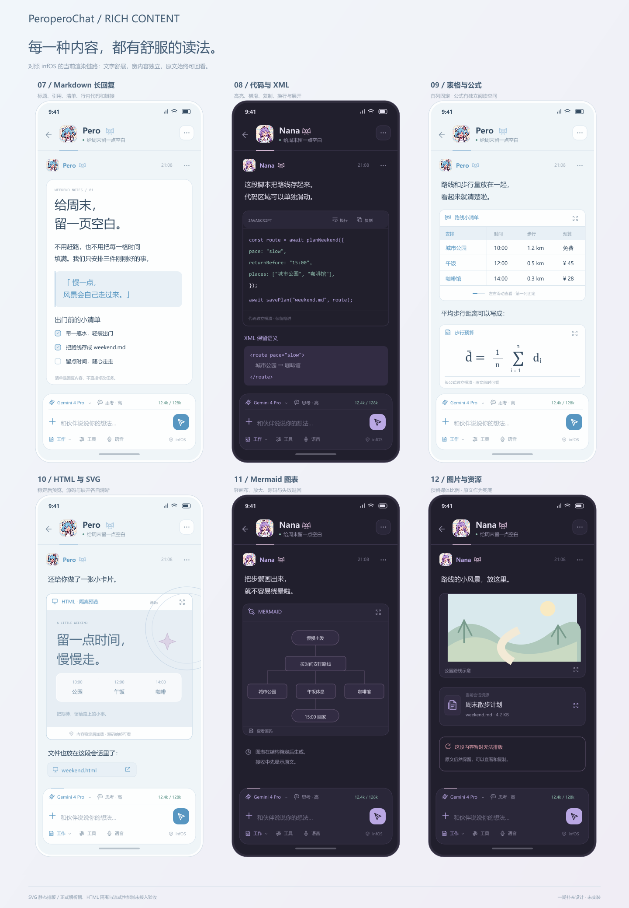
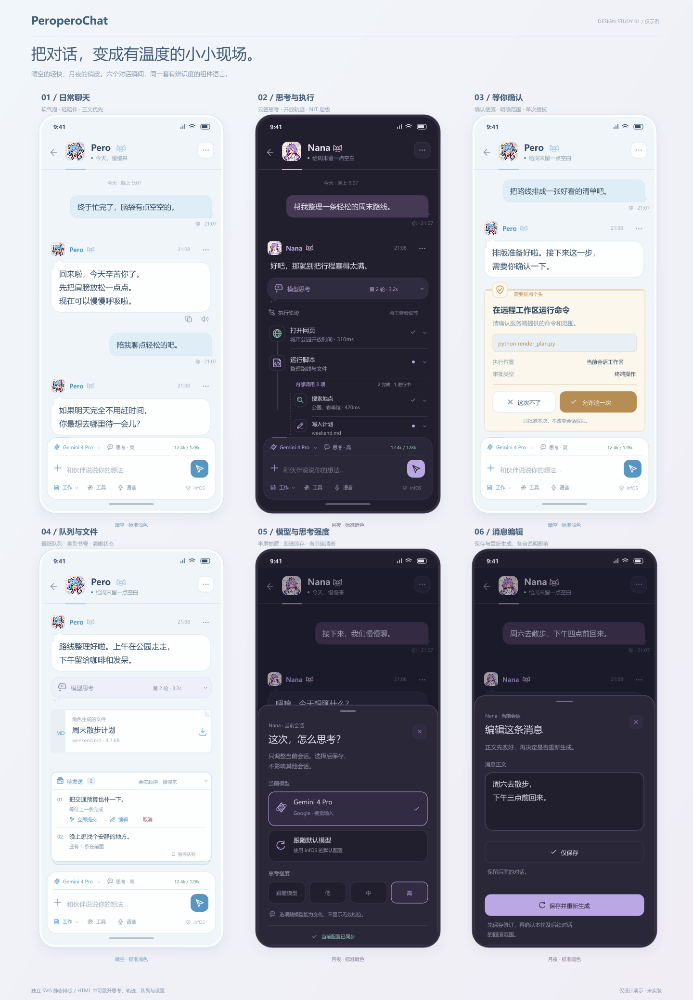
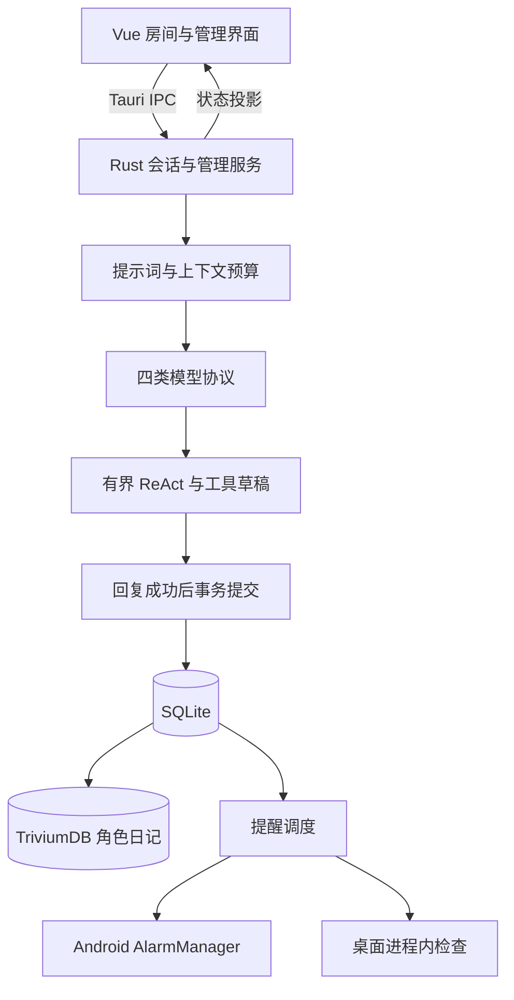

<a id="top"></a>

<div align="center">
  
  <h1>PeroperoChat</h1>
  <p>以角色房间为中心的 AI 陪伴聊天应用。<br />和 Pero、Nana 聊天，她们会自己写日记、设提醒；也可以连上你自己的 infOS，在手机和电脑上随时接着用。</p>
  <p>
    <a href="https://github.com/YoKONCy/PeroperoChat/releases/latest"></a>
    <a href="https://github.com/YoKONCy/PeroperoChat/releases"></a>
    <a href="./LICENSE"></a>
    <a href="https://github.com/YoKONCy/PeroperoChat/stargazers"></a>
    <a href="https://github.com/YoKONCy/PeroperoChat/releases/latest"></a>
  </p>
  <p><a href="#quick-start"><b>下载安装</b></a>　/　<a href="#features"><b>功能</b></a>　/　<a href="#modes"><b>两种模式</b></a>　/　<a href="#developers"><b>开发者</b></a>　/　<a href="docs/"><b>文档</b></a>　/　<a href="https://github.com/YoKONCy/PeroperoChat/issues"><b>反馈</b></a></p>
</div>

<br />

<a href=".github/assets/standalone-light-v2.png"></a>
<p align="right"><sub>独立模式设计稿（非最终界面截图）：房间 / 对话 / 衣柜 / 设置</sub></p>

<p align="center">
  <a href="#characters">角色</a> · <a href="#features">功能</a> · <a href="#modes">独立模式与 infOS 客户端</a> · <a href="#privacy">数据与隐私</a> · <a href="#quick-start">下载与运行</a> · <a href="#status">当前状态</a> · <a href="#developers">开发者</a> · <a href="#license">许可</a>
</p>

---

PeroperoChat 是一个开源应用，基于 Vue 3、Tauri 2 与 Rust，支持 Android（ARM64）和桌面端。它有两种用法：

- **独立模式**：开箱即用，本地运行一套精简的 ReAct。模型请求、提示词编译、工具调用、日记和提醒都由 Rust 端完成，不依赖任何服务器。调用在线模型时，本轮上下文会发送给你自己配置的模型服务。
- **infOS 客户端**：扫码或粘贴配对码，连接你自己运行的 [infOS](https://github.com/YoKONCy/infOS)。聊天、任务和记忆以服务端为准，手机负责随身使用：队列会话、审批、通知、文件、远程管理。

两种模式的数据各自独立，不互通。

<a id="characters"></a>

## 角色

应用内置两位角色，人设、立绘、房间背景、欢迎语和主题色都可以在角色管理里修改，也可以新建完全自定义的角色。

<table>
  <tr>
    <td width="50%" align="center" valign="top">
      
      <h3>Pero</h3>
      <p>Nana 的姐姐。猫耳、蓝色渐变短双马尾，设定是「可爱但克制」的数字生命体：喜欢卖萌，但做事干脆，能一句话说清的绝不啰嗦。欢迎语是「主人你好！我是Pero呀！有什么我可以帮你的吗？」</p>
      <p><sub>透明 SVG 立绘 · 粉色主题</sub></p>
    </td>
    <td width="50%" align="center" valign="top">
      
      <h3>Nana</h3>
      <p>Pero 的妹妹，傲娇设定。紫发紫瞳，嘴上不饶人，爱叫你「杂鱼主人」，其实很黏人；被夸了会嘴硬地「哼~」一声，紧张时会结巴。对陌生人和其他 AI 则保持礼貌与边界。</p>
      <p><sub>透明 PNG 立绘 · 紫色主题</sub></p>
    </td>
  </tr>
</table>

自定义素材（立绘、CG、房间背景图）会原样保留；升级到新版本时，旧版默认 CG 会自动迁移。

<a id="features"></a>

## 功能

### 房间与聊天

- **流式对话**：回复逐字输出，思考过程折叠在单独区域；支持中途停止、重新生成、删除单条消息和图片附件。对话面板可以收起、半展开或全屏阅读，长对话按需加载历史，不会一次渲染全部消息。
- **Live2D 与立绘切换**：首页可随时在 Pio Live2D 模型和角色静态立绘／CG 之间切换，选择由 Rust 端保存，重启后恢复。展开阅读时自动暂停 Live2D 绘制以节省性能。
- **衣柜**：展示各套服装贴图的缩略图，完整上身效果由 Live2D 模型呈现。
- **房间背景**：多套按时间变化的场景（晴日、黄昏、夜晚等），配色、玻璃材质透明度、立绘大小和动效幅度都能调；系统开启「减少动画」时界面会自动收敛动效。
- **家庭群聊**：Pero 和 Nana 在同一间小客厅里，用各自的角色色气泡发言。可以挑选参与成员、调整回应顺序，支持整轮停止、消息复制与删除。
- **其他空间**：保留群聊入口和一局 21 点小游戏。

### 日记（独立模式）

角色在对话中可以调用 `write_diary` 工具，把发生的事写进自己的日记库（Pero 和 Nana 各有一个，互不相通）。日记支持按日期浏览和关键词检索，使用本地的 TriviumDB，不做向量检索。

写入有一道保险：日记、角色状态、提醒这类工具调用先生成草稿，只有当整轮回复成功落盘后，草稿才会和消息在同一个数据库事务里提交。停止、超时、失败或版本冲突时，草稿直接丢弃，不会留下半截记录。删除对话或重新生成回复时，由这段内容产生的日记会一并回滚。

### 提醒

支持一次性、每天、每周三种重复方式，以及重复截止时间。管理界面可以查询、编辑、取消提醒并查看系统权限状态。

- **Android**：接入系统 `AlarmManager` 和原生 Receiver，关闭应用后仍可触发通知，重复提醒到期自动续排，开机解锁后恢复；没有精确闹钟权限时自动降级。
- **桌面**：应用进程运行时每 15 秒检查一次，不提供退出后的系统唤醒。
- 错过的周期提醒只补一次，不会连环通知。

### 模型与参数

兼容四类接口：**OpenAI Chat Completions、OpenAI Responses、Anthropic Messages、Google Gemini**，也支持自定义 API 地址和在线拉取模型列表。服务商按实际域名、模型按模型 ID 显示本地品牌图标。

设置里可调思考强度、Temperature、Top P、输出额度、上下文窗口、历史轮次和流式开关；后端还支持思考方言、自定义请求头、扩展请求体和工具循环上限等高级字段。参数是否生效取决于具体模型，不保证所有模型都接受全部档位。

### 远程对话的富内容

连接 infOS 时，消息里的 Markdown、代码高亮、KaTeX 公式、Mermaid 图表、表格和隔离的 HTML／SVG 都能直接渲染；图片可在消息内浏览放大，文档可以小窗打开成独立阅读面板。

<p align="center">
<a href=".github/assets/rich-content-overview.png"></a>
</p>
<p align="center"><sub>远程对话富内容设计稿（非最终界面截图）</sub></p>

<a id="modes"></a>

## 两种模式

| | 独立模式 | infOS 客户端 |
| :--- | :--- | :--- |
| 依赖 | 自备模型服务的 API 地址和 Key | 一台运行新版 infOS 的设备 |
| 数据 | 全部保存在本机 | 聊天／任务／记忆以服务端为准；显示偏好、草稿、阅读位置按连接存在本机 |
| 角色与日记 | 本地管理，角色间独立 | 来自服务端 |
| 入口 | 默认模式 | 房间菜单的「infOS 客户端」或设置中的「运行模式与远程连接」 |

模式切换由一个运行令牌控制：切换时先停掉旧模式的所有进行中请求，再激活新模式；切换失败会停在安全状态而不是混用两套数据。

### infOS 客户端能做什么

- **配对**：用系统相机扫描 infOS「局域网与设备」页的配对二维码，或直接粘贴配对链接。地址和一次性配对码由 Rust 校验；扫码只填表，局域网 HTTP 必须手动勾选允许，配对码不写日志。
- **五栏布局**：角色首页、会话、任务、资料、管理；通知和审批从页头进入，默认恢复上次的会话和角色。
- **会话队列**：提交到 `/api/chat/queue/:threadId`，排队时可以继续输入、置顶、编辑、取消、暂停／继续或调整顺序；流式内容实时显示，轮询补偿队列和正在生成的状态。每条消息使用持久 UUID，断线重连后按服务端队列核对身份，不会因为正文相同就重复发送。
- **文件**：原件流式下载保存（单文件上限 2 GiB），有进度、可取消；支持 PDF 分页预览、Markdown、HTML 会话资源、DOC／DOCX 正文速览、电子表格和 ZIP 目录浏览。
- **管理与工作台**：模型与服务商配置、角色与提示词发布、资料管理、会话的模型／工具／消息操作、文件编辑、终端、据点群聊、调度、设备接入与维护重置。业务全部由 infOS 执行，敏感配置不写入手机投影缓存。
- **Android 后台接收**：可选开启独立原生进程的常驻通知服务，不加载界面、不依赖 Google 服务，支持断线重连、去重和点击跳转。默认关闭，受系统后台策略限制；厂商级系统推送（如国内推送通道）尚未接入。

远程模式需要支持队列接口的新版 infOS。

<p align="center">
<a href=".github/assets/conversation-overview.png"></a>
</p>
<p align="center"><sub>远程对话设计稿（非最终界面截图）：思考过程、工具轨迹、队列与消息操作</sub></p>

<a id="privacy"></a>

## 数据与隐私

| 数据 | 位置 |
| :--- | :--- |
| 配置、角色、对话、提醒 | 本机 SQLite |
| 角色日记 | 本机 TriviumDB（每个角色一个 `memory.tdb`），SQLite 另存恢复镜像 |
| infOS 连接凭据 | Windows DPAPI / Android Keystore / iOS Keychain，不写明文 |
| 远程显示偏好、草稿、阅读位置 | 本机，按连接分区 |
| 备份 | 手动导出的 JSON（含配置、角色、日记、提醒与对话） |

应用没有账号体系，代码中也没有统计或遥测。恢复备份和重置数据会覆盖当前内容，操作前建议先导出备份。

<a id="quick-start"></a>

## 下载与运行

### Android

1. 到 [Releases](https://github.com/YoKONCy/PeroperoChat/releases/latest) 下载 `PeroperoChat-v<版本>-arm64.apk`（仅 ARM64，Android 7.0 及以上）。
2. 安装时允许「未知来源」。
3. 打开后进入 **设置 → 模型连接**，填写服务商地址、API Key 和模型即可使用独立模式。
4. 连接 infOS：进入 **设置 → 运行模式与远程连接**，扫码或粘贴配对链接。

> **从 1.4.0 之前的版本升级请注意**：旧版 CI 每次构建使用临时 debug 签名，旧包无法直接覆盖安装新版。请先在旧应用内导出 JSON 备份，卸载旧包后安装 1.4.0+ 并恢复备份，远程连接需要重新配对。1.4.0 起使用固定发布密钥，之后版本均可正常覆盖升级。

### 从源码运行

需要 Node.js 20+、pnpm 9、Rust stable，以及对应平台的 Tauri 依赖；Android 另需 Java 17、Android SDK 36 与 NDK r26c。

```bash
git clone https://github.com/YoKONCy/PeroperoChat.git
cd PeroperoChat
pnpm install --frozen-lockfile

pnpm desktop   # Vite + Tauri 桌面应用
pnpm android   # Android 真机或模拟器
pnpm dev       # 仅前端，浏览器内没有 Tauri IPC，独立模式不可用
```

仓库自带的 `src-tauri/gen/android` 包含自定义提醒桥接，不要重新初始化覆盖。iOS 工程尚未初始化，需要在 macOS + Xcode 环境自行处理。

推送 `v<版本号>` tag 会触发 GitHub Actions 构建 Android ARM64 APK 并创建 Release，发布前会校验签名证书指纹，流程见 [构建与发布](docs/BUILD_AND_RELEASE.md)。

<a id="status"></a>

## 当前状态与限制

当前版本 **1.4.6**。以下限制在使用前值得知道：

- **需要自备模型服务**：应用本身不提供任何模型或 API 额度。
- **自动发布只有 Android ARM64 APK**：桌面安装包和 iOS 需要自行构建。
- **远程模式仍待真机验收**：真实 infOS 连接、扫码链路和手机端端到端测试还在进行；iOS 凭据分支同样未经真机验证。
- **后台能力因平台而异**：Android 常驻通知默认关闭且受厂商后台策略影响，没有接入厂商级系统推送；iOS 没有等价的后台调度方案；桌面提醒只在应用运行时生效。
- 每轮发布前的测试数量和未验证范围记录在 [构建与发布](docs/BUILD_AND_RELEASE.md)，源码测试不代替视觉与真机验收。

<a id="developers"></a>

## 开发者

架构原则很简单：**Rust 端是唯一权威，前端只表达意图**。前端不直接请求模型、不执行工具、不编译提示词；所有校验、落盘和模式切换都在 Rust 完成，IPC 必须携带原生运行令牌。



- **有界 ReAct**：单轮最多 8 次模型调用、24 次工具调用；独立模式只有五个工具：`write_diary`、`query_diary`、`update_character`、`query_reminders`、`manage_reminder`。
- **模型适配**：四类协议统一归一化流式输出与工具调用，保留各家的原生工具调用 ID 和签名；流式工具参数累积成完整 JSON 后才执行。
- **远程端是薄客户端**：Rust 只负责传输、身份隔离和展示投影；WebSocket 负责流式消息、补发和心跳，HTTP 客户端禁用自动重定向，错误信息脱敏。
- **存储恢复**：TDB 同步失败时在 SQLite 记录恢复任务补偿，不会假装写入成功。

```bash
pnpm test        # 前端：传输、消息渲染、品牌识别、全部 Vue 组件模板内存校验
pnpm test:rust   # Rust 后端测试（网络测试使用本地模拟服务）
pnpm lint        # ESLint
```

### 文档

- [独立模式技术文档](docs/STANDALONE.md)：架构、工具、日记、提示词、模型、界面与安卓提醒
- [infOS 远程客户端技术文档](docs/REMOTE_CLIENT.md)：双模式控制、连接、UI、渲染、文件与管理
- [构建与发布技术文档](docs/BUILD_AND_RELEASE.md)：版本维护、签名校验、测试口径与版本记录
- 原始过程文档与设计稿归档于 `docs/archived/`（本地保留，不入库）

<a id="license"></a>

## 许可

项目以 **GPL-3.0** 开源。Live2D 模型与角色素材的权利归各自作者；模型与服务商品牌图标的来源及 MIT 许可见 [图标来源](public/model-brands/SOURCES.md)。AI 生成内容可能不准确，请自行判断。

欢迎通过 Issue 和 PR 参与，无论是开发、设计、素材还是使用反馈。

<a href="https://github.com/YoKONCy/PeroperoChat/graphs/contributors">
  
</a>

<p align="center"><a href="#top">回到顶部 ↑</a> · <a href="https://github.com/YoKONCy/PeroperoChat/releases/latest">下载最新版本</a></p>
