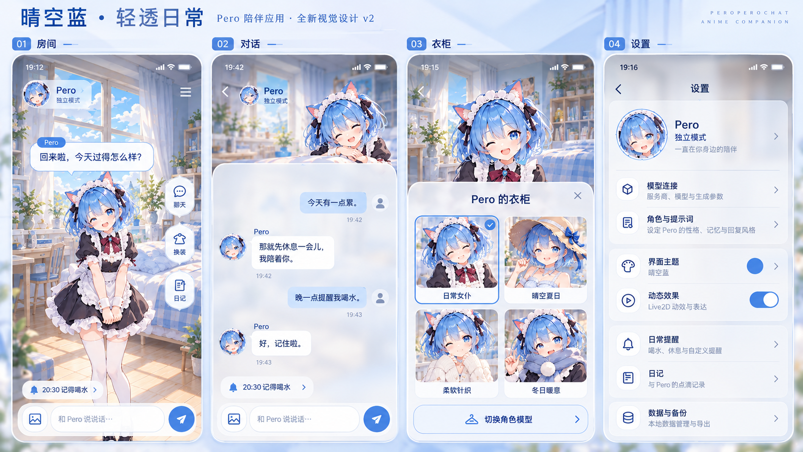
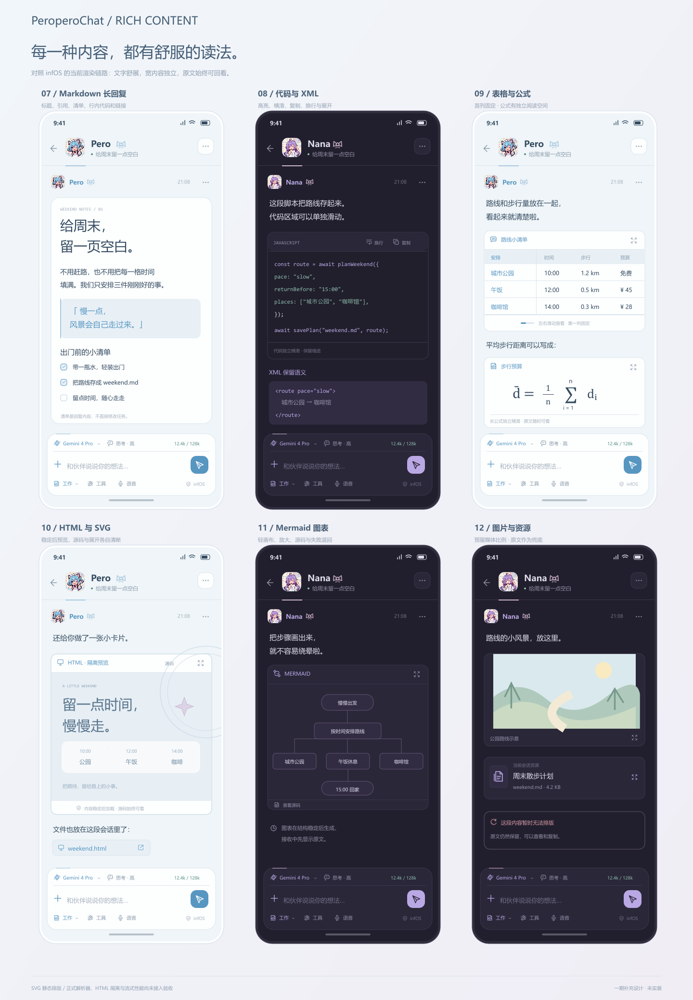
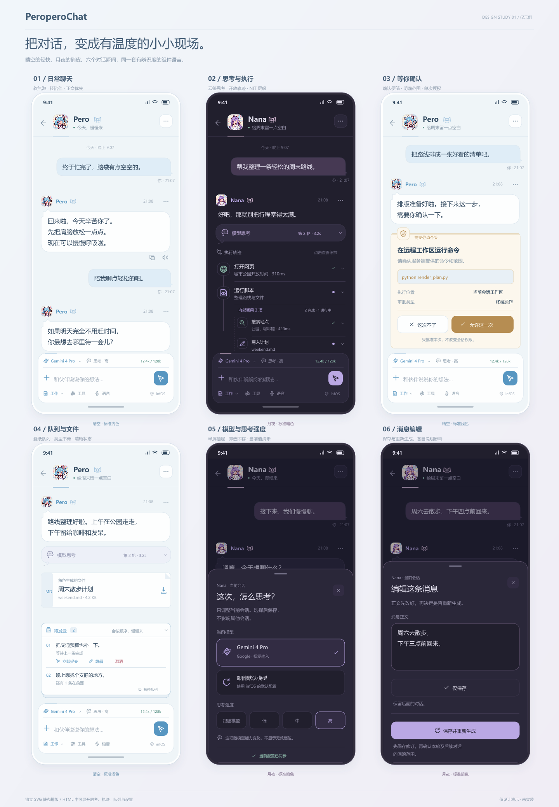
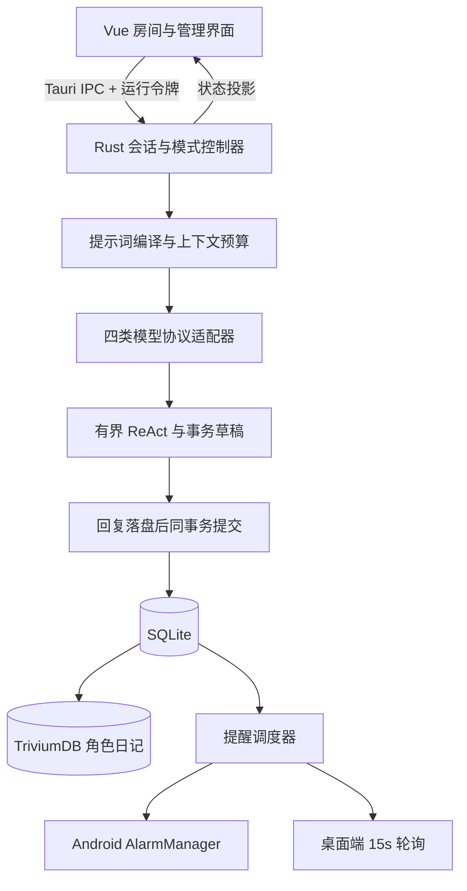

<a id="top"></a>

<div align="center">
  
  <h1>PeroperoChat</h1>
  <p>以角色房间为中心的跨端 AI 陪伴与远程工作台应用。<br />单机就能陪你聊天、记日记、定闹钟；连上 <a href="https://github.com/YoKONCy/infOS">infOS</a>，手机与桌面随时接着干活。</p>
  <p>
    <a href="https://github.com/YoKONCy/PeroperoChat/releases/latest"></a>
    <a href="https://github.com/YoKONCy/PeroperoChat/releases"></a>
    <a href="./LICENSE"></a>
    <a href="https://github.com/YoKONCy/PeroperoChat/stargazers"></a>
    <a href="https://github.com/YoKONCy/PeroperoChat/releases/latest"></a>
  </p>
  <p><a href="#quick-start"><b>下载安装</b></a>　/　<a href="#features"><b>功能</b></a>　/　<a href="#modes"><b>两种模式</b></a>　/　<a href="#developers"><b>开发者</b></a>　/　<a href="docs/"><b>文档</b></a>　/　<a href="https://github.com/YoKONCy/PeroperoChat/issues"><b>反馈</b></a></p>
</div>

<br />

<a href=".github/assets/standalone-light-v2.png"></a>
<p align="right"><sub>独立模式视觉预览：房间 / 对话 / 衣柜 / 设置</sub></p>

<p align="center">
  <a href="#characters">角色</a> · <a href="#features">功能</a> · <a href="#modes">独立模式与 infOS 客户端</a> · <a href="#privacy">数据与隐私</a> · <a href="#quick-start">下载与运行</a> · <a href="#status">版本与平台说明</a> · <a href="#developers">开发者</a> · <a href="#license">许可</a>
</p>

---

PeroperoChat 基于 Vue 3、Tauri 2 与 Rust 构建，覆盖 Android（ARM64）和桌面端，提供两种互不干扰的运行模式：

- **独立模式**：开箱即用的本地陪伴应用。提示词编译、有界 ReAct 循环、角色日记和系统提醒全部由本地 Rust 核心驱动，填好自己的模型 API 即可使用，不依赖外部后端。
- **infOS 客户端**：扫码或粘贴配对链接，直连你自己的 [infOS](https://github.com/YoKONCy/infOS) 实例。把桌面端的对话队列、审批流、工作台文件、终端和扩展管理完整带到随身设备上。

两种模式的数据完全隔离，切换时自动停用旧模式会话并校验运行令牌。

<a id="characters"></a>

## 角色

应用内置两位性格截然不同的看板娘伙伴，各有独立的日记空间、主题配色与立绘表现：

<table>
  <tr>
    <td width="50%" align="center" valign="top">
      
      <h3>Pero</h3>
      <p>infOS 看板娘，元气满满又贴心的万能小女仆。猫耳、天蓝色眼瞳加上蓝色渐变短双马尾，性格轻快活泼、擅长接梗，一旦和主人聊起来就会十分投入。</p>
      <p><sub>默认静态 SVG 立绘 · 晴空蓝主题</sub></p>
    </td>
    <td width="50%" align="center" valign="top">
      
      <h3>Nana</h3>
      <p>紫发紫瞳的精灵族「雌小鬼」妹妹。嘴上总喜欢叫你「杂鱼主人」、摆出一副挑衅虚张声势的样子，其实超级黏人——被夸会别扭地「哼~」一声，紧张起来还会结巴；对陌生人则很有礼貌。</p>
      <p><sub>默认静态 PNG 立绘 · 月夜紫主题</sub></p>
    </td>
  </tr>
</table>

> 在「房间 → 角色与外观」或「角色管理」中可以随时切换当前陪伴角色，也能自行扩展或调整角色设定。

<a id="features"></a>

## 功能

### 房间与交互

- **三状态对话面板**：流式输出回复，思考过程独立折叠；支持随时停止、重新生成、删除单条消息和附带图片阅读。面板可在「收起看房间 / 半展开聊天 / 全屏长读」之间切换，长历史记录按需分段加载。
- **立绘与 Live2D 双显示**：默认展示高清静态立绘，可随时切为 Pio Live2D 模型；选择由 Rust 持久化保存，全屏展开阅读时自动暂停 Live2D 绘制以节省电量与性能。
- **衣柜与房间氛围**：Live2D 模式下支持切换多套服装；房间背景按本地时间在 **清晨/黄昏（05:00–08:00、17:00–20:00）、白天（08:00–17:00）、晚上（20:00–05:00）** 自动流转，内置 **晴空蓝、樱花粉、薄荷青、月夜紫** 四套配色，并可微调毛玻璃透明度、立绘比例与动态效果。
- **家庭群聊与小客厅**：进入「大家的小客厅」，让 Pero 和 Nana 在同一房间里用各自的角色色气泡轮流接话，支持自选出场成员和发言顺序。
- **休闲小游戏**：内置一局轻量 21 点，聊天间隙换个心情。

### 日记与持久化（独立模式）

对话过程中角色可主动调用 `write_diary` / `query_diary` 记录与检索日常，Pero 和 Nana 各自拥有独立的本地 **TriviumDB（`memory.tdb`）**，通过日期与关键词精确检索，不引入外部向量库。

所有伴随对话产生的日记写入、角色印象更新和提醒变更，都会先生成事务草稿，**仅在整轮回复确认成功后与消息同事务提交**；中途取消、超时或失败时自动回滚，删除消息或重新生成也会连带撤销该轮产生的记忆写入。

### 系统提醒

支持一次性、每天、每周重复以及设置截止时间，界面内可直接查看系统授权状态、修改或取消日程：

- **Android**：接入原生 `AlarmManager` 与广播接收器，退出应用后也能准点弹出通知，周期任务自动续排，重启解锁后自动恢复（无精确闹钟权限时平滑降级）。
- **桌面端**：进程运行期间每 15 秒轮询调度；过期的周期任务仅补偿触发一次，避免连环弹窗。

### 多模型协议兼容

完整适配四类主流接口：**OpenAI Chat Completions、OpenAI Responses、Anthropic Messages、Google Gemini**，支持自定义 Base URL 与在线拉取模型列表，并根据服务商域名与模型 ID 自动匹配本地品牌图标。

支持调节思考强度（Reasoning Effort / Dialect）、Temperature、Top P、最大输出、上下文窗口、历史轮次、流式开关以及自定义请求头与扩展参数。

### 富内容渲染

在 infOS 远程工作台与会话流中，长文档与工程内容原生开箱即用：支持完整 Markdown、Syntax Highlight 代码块、KaTeX 数学公式、Mermaid 流程图、表格、沙盒隔离的 HTML/SVG 预览，以及图片灯箱与文档小窗阅读器（PDF、Office 正文速览、电子表格与 ZIP 目录浏览）。

<p align="center">
  <a href=".github/assets/rich-content-overview.png"></a>
</p>
<p align="center"><sub>富内容排版预览：Markdown / 代码与 XML / 表格与公式 / HTML 与 SVG / Mermaid 图表 / 图片与资源</sub></p>

<a id="modes"></a>

## 两种模式

| 维度 | 独立模式 | infOS 客户端 |
| :--- | :--- | :--- |
| **运行依赖** | 自备模型 API 地址与 Key | 一台运行新版 infOS 的设备 |
| **权威数据源** | 全部保存在本机 | 对话、任务与记忆以服务端为准；界面偏好、草稿与阅读位按连接存在本机 |
| **角色与扩展** | 本地角色、日记与提醒 | 同步服务端角色、Skills、插件、MCP、SelfMind 与终端能力 |
| **切换入口** | 默认启动模式 | 房间菜单或 **设置 → 运行模式与远程连接** |

### infOS 客户端能做什么

- **安全配对连接**：用相机扫描 infOS 控制台的配对二维码，或直接粘贴配对链接；支持多配置档案管理与受控的局域网 HTTP 开关，配对凭据不落明文日志。
- **五栏随身工作区**：**首页、会话、任务、资料、管理** 五个主视图直达日常，页头集合连接状态与「通知和待处理事项」入口，重新打开时默认恢复上次的会话与角色。
- **不断线的队列会话**：支持在 AI 生成期间继续排队追加多条指令，随时置顶、编辑、暂停、取消或重排优先级。每条消息绑定持久 UUID，断线重连后自动从 WebSocket 序号与队列快照无缝续传。
- **流式文件传输与预览**：支持原件流式下载（单文件最高 2 GiB）与传输进度取消；支持 PDF（最高 512 MiB）分页预览、Markdown / HTML 会话产物、Word / 表格 / ZIP 归档速览。
- **完整远程管理**：涵盖角色与陪伴、模型与语音（含 TTS 朗读）、扩展与能力（Skills、Packages、MCP、提示词、SelfMind）、工作台终端、据点群聊、定时调度以及连接与设备维护。
- **Android 独立后台接收**：可按需开启原生独立前台服务监听事件流（不依赖 Google 服务或厂商推送通道），支持断线重连、消息去重与点击直达会话。

<p align="center">
  <a href=".github/assets/conversation-overview.png"></a>
</p>
<p align="center"><sub>远程会话预览：日常聊天 / 思考与执行 / 等你确认 / 队列与文件 / 模型与思考强度 / 消息编辑</sub></p>

<a id="privacy"></a>

## 数据与隐私

| 数据类型 | 存储位置与保护机制 |
| :--- | :--- |
| 配置、角色、历史消息与提醒 | 本机 SQLite（独立模式与远程档案隔离存储） |
| 角色日记记忆 | 每个角色独立拥有本地 TriviumDB（`memory.tdb`），并在 SQLite 保留同步恢复镜像 |
| infOS 连接凭据 | 分别托管于 Windows DPAPI / Android Keystore / iOS Keychain |
| 远程界面偏好、草稿与进度 | 本机分连接独立存储 |
| 整库备份 | 手动导入/导出结构化 JSON 快照 |

应用无内置账号系统、无遥测埋点；在线模型对话仅发往你自行配置的服务端接口，连接 infOS 时数据仅在你与自己的服务端之间流转。

<a id="quick-start"></a>

## 下载与运行

### 安装 Android APK

1. 前往 [Releases](https://github.com/YoKONCy/PeroperoChat/releases/latest) 下载 `PeroperoChat-v<版本>-arm64.apk`（支持 Android 7.0+ ARM64 设备）。
2. 安装后进入 **设置 → 模型连接**，填好接口地址、API Key 与模型即可开启独立模式。
3. 如需连接桌面端，进入 **设置 → 运行模式与远程连接** 扫码或粘贴配对码即可。

> **1.4.0 以前旧版升级提示**：早期 CI 曾使用临时调试签名构建。若本机装有 1.4.0 之前的安装包，请先在旧应用内导出 JSON 备份，卸载后再安装新版并导入恢复。自 1.4.0 起已固定正式发布签名，后续版本均支持直接覆盖升级。

### 从源码运行

环境要求：**Node.js 20+**、**pnpm 9**、**Rust stable** 及对应平台 Tauri 构建依赖；构建 Android 另需 **Java 17**、**Android SDK 36** 与 **NDK r26c**。

```bash
git clone https://github.com/YoKONCy/PeroperoChat.git
cd PeroperoChat
pnpm install --frozen-lockfile

pnpm desktop   # 启动 Vite + Tauri 桌面端
pnpm android   # 连接 Android 真机或模拟器运行
pnpm dev       # 仅启动前端视图（无 Tauri IPC，独立/原生能力不可用）
```

> 仓库中的 `src-tauri/gen/android` 含定制的原生提醒与后台通知桥接，请勿重新执行 Tauri Android 初始化覆盖。iOS 工程目录暂未预置，如需构建请先在 macOS + Xcode 环境初始化；推送 `v<版本号>` 标签将由 GitHub Actions 自动构建并校验签名后发布 Android ARM64 APK，详见 [构建与发布文档](docs/BUILD_AND_RELEASE.md)。

<a id="status"></a>

## 版本与平台说明

当前版本为 **v1.6.0**。使用前建议了解以下边界：

- **自备模型与服务端**：应用不内置免费模型额度；远程模式需搭配支持会话队列的新版 infOS 使用。
- **发布产物范围**：GitHub Release 目前自动提供 Android ARM64 安装包；Windows / macOS / Linux 桌面端与 iOS 需本地从源码构建。
- **平台后台差异**：Android 独立后台通知服务默认关闭且受各机型省电策略影响（未接入厂商系统推送）；桌面端提醒仅在应用进程运行时检查触发；iOS 暂未实现等价后台唤醒，Keychain 分支尚未完成真机实测。

<a id="developers"></a>

## 开发者

技术架构围绕一个核心准则展开：**Rust 后端是状态校验、数据落盘与运行模式切换的唯一真源，Vue 前端仅负责发送意图与渲染状态投影**。



- **有界 ReAct 与五工具集**：独立模式单轮模型调用上限支持 **1–12 次可配置（默认 8 次）**，工具调用上限 24 次；内置工具精简聚焦为 `write_diary`、`query_diary`、`update_character`、`query_reminders`、`manage_reminder`。
- **统一流式协议归一化**：四类 API 返回统一转换为内部事件流，完整保留原生 Tool Call ID、思考签名与不完整的流式 JSON 参数缓冲。
- **稳健的远程传输层**：远程 HTTP 客户端禁用自动重定向并对错误日志脱敏；WebSocket 负责实时事件推流与增量序号补偿；TDB 写入若异常会在 SQLite 记录恢复任务并自动补偿。

### 常用检查命令

```bash
pnpm test        # 前端单元测试与 Vue 组件模板编译校验
pnpm test:rust   # Rust 后端测试（本地模拟服务隔离外部网络）
pnpm typecheck   # vue-tsc 类型检查
pnpm lint        # ESLint 代码规范检查
```

### 技术文档导航

- [独立模式技术文档](docs/STANDALONE.md)：架构设计、日记与事务、提示词拼装、四协议适配与原生提醒桥接
- [infOS 远程客户端技术文档](docs/REMOTE_CLIENT.md)：模式门控、安全配对、WebSocket 断线续传、富内容渲染与文件管理
- [构建与发布技术文档](docs/BUILD_AND_RELEASE.md)：版本同步点、签名证书校验、构建流与验收记录

<a id="license"></a>

## 许可与致谢

本项目以 **GPL-3.0** 协议开源。Live2D 模型与角色立绘素材版权归各自原作者所有；模型及服务商品牌图标的来源与 MIT 许可声明详见 [图标来源](public/model-brands/SOURCES.md)。

欢迎提交 Issue 或 Pull Request 参与改进——无论代码、视觉设计还是使用反馈都非常感谢。

<a href="https://github.com/YoKONCy/PeroperoChat/graphs/contributors">
  
</a>

<p align="center"><a href="#top">回到顶部 ↑</a> · <a href="https://github.com/YoKONCy/PeroperoChat/releases/latest">下载最新版本</a></p>
