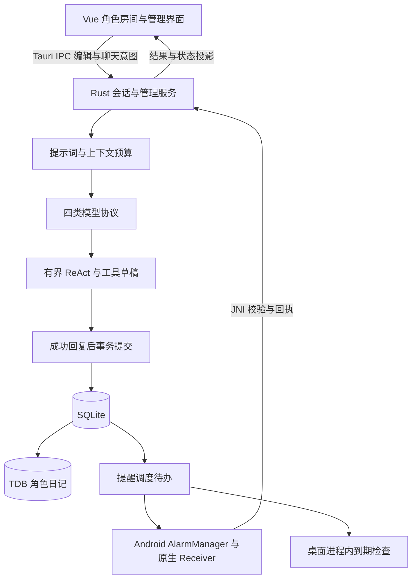

<div align="center">

<h1>PeroperoChat</h1>

<p>以角色陪伴空间为中心的 AI 聊天应用，基于 Vue 3、Tauri 2 与 Rust。</p>


</div>

当前版本：**1.3.4**。主要面向独立运行的本地陪伴与助手场景，包含 Pero、Nana 两位内置角色及各自的房间。

## 模式与定位

- **独立模式**：参考 infOS 的职责划分，运行自己的精简 ReAct、角色、提示词、对话与日记。无需连接 infOS，数据与 infOS 不互通。调用在线模型时，所需上下文仍会发送给用户配置的模型服务；使用本地模型服务则取决于该服务的部署方式。
- **远程模式**：目标是成为必须连接远程 infOS 的完整客户端。仓库中保留的远程连接界面与旧协议不代表已经完成新版 infOS 客户端接入，主子应用架构与远程托管连接仍属后续工作。

## 当前能力

### 角色陪伴与界面

- Pero 与 Nana 使用不同配色和项目内 SVG 房间背景，首页保留 Live2D、触摸台词与角色切换。
- 对话面板支持收起、半展开与完整阅读，提供流式正文、思考内容、图片附件、重新生成、取消和删除。
- 衣柜展示现有服装贴图的细节缩略，完整上身效果由主 Live2D 模型展示；日记、提醒和角色资料使用独立抽屉。
- 设置、角色管理及既有页面共用主题与导航；服务商按实际 API 域名、模型按模型 ID 自适应显示本地品牌图标。
- 轻量点按反馈、选中动画和展开过渡支持系统“减少动画”偏好，不使用 emoji 充当界面图标。

### 模型连接与参数

支持四类 API：**OpenAI Chat Completions、OpenAI Responses、Anthropic Messages、Google Gemini**，提供服务商预设、自定义地址、模型列表查询，以及协议对应的流式与工具调用处理。

设置界面可编辑思考强度、Temperature、Top P、输出额度、上下文窗口、历史轮次和流式开关。后端另支持思考方言、自定义请求头、扩展请求体、可选字段禁用及工具循环限制；这些高级字段尚未全部提供界面编辑入口，保存普通设置会保留未编辑字段。具体参数是否有效取决于所选模型和服务商，不保证所有模型接受全部档位。

### 精简 ReAct、提示词与日记

独立模式提供五个小工具：

| 工具 | 用途 |
| --- | --- |
| `write_diary` | 写入或修订当前角色的日记 |
| `query_diary` | 按关键词和日期查询日记 |
| `update_character` | 在同一个工具中更新角色状态与互动台词 |
| `query_reminders` | 查询当前角色提醒与设备时间 |
| `manage_reminder` | 创建、修改或取消提醒 |

日记使用 **TriviumDB（TDB）**，按角色独立保存，采用日期和文本检索，**不使用 Embedding 或向量检索**。不再要求一次模型回复同时夹带记忆提炼、状态与台词控制标签；写入工具先产生草稿，在最终回复成功持久化后提交，失败、停止或冲突会丢弃未提交草稿。

Rust 提示词框架支持区块、白名单变量、历史预算、草稿、发布、预览与回滚；目前已提供管理接口，专用提示词工作区编辑界面尚未提供。内置人设、用户资料与角色日记由后端统一编译进上下文。

### 提醒、备份与数据管理

- 提醒支持一次、每天、每周及重复截止时间，管理界面提供查询、编辑、取消与系统权限状态。
- **Android** 已接入 `AlarmManager`、原生 Receiver 与 JNI/Rust 核心，支持系统登记、到期通知、重复续排及开机解锁后的恢复。未获精确提醒权限时会降级；系统强制停止、通知权限和厂商后台限制仍会影响运行。该链路尚未经过安卓真机验收。
- **桌面端** 在应用进程运行时由 Rust 每 15 秒检查到期提醒；不提供进程退出后的系统唤醒。**iOS** 尚未接入与安卓等价的后台调度方案。
- SQLite 保存配置、角色、对话、日记恢复镜像和提醒事务；TDB 同步失败保留恢复任务。删除、重新生成和设置写入由 Rust 校验并提交，前端只维护表单草稿与显示状态。
- JSON 备份包含配置、角色、日记、提醒与对话，支持导出、恢复及旧数据迁移。恢复和重置会覆盖当前数据，操作前请保存备份。

## 架构



前端不直接请求 LLM、不执行工具，也不承担提示词编译、日记提炼、循环提醒计算等业务规则。界面图标识别、搜索列表过滤和动画属于展示逻辑。

详见 [独立模式架构](docs/STANDALONE_ARCHITECTURE.md)、[陪伴空间界面](docs/COMPANION_ROOM_UI.md)、[安卓系统提醒](docs/ANDROID_REMINDERS.md)。

## 开发与运行

环境要求：**Node.js 20+、pnpm 9、Rust stable**，以及当前系统所需的 Tauri 开发依赖。安卓开发另需 Java、Android SDK 与 NDK；iOS 开发需要 macOS 与 Xcode。当前发布工作流使用 Java 17、Android SDK 36 和 NDK r26c。

```bash
git clone https://github.com/YoKONCy/PeroperoChat.git
cd PeroperoChat
pnpm install --frozen-lockfile

# 启动桌面完整应用，包含 Vite 与 Tauri/Rust
pnpm desktop

# Android 真机或模拟器调试
pnpm android
```

`pnpm dev` 仅启动前端开发服务，普通浏览器不具备独立模式所需的 Tauri IPC。仓库已经包含带自定义提醒桥接的 `src-tauri/gen/android`，不要直接重新初始化覆盖原生工程。iOS 工程需要在对应开发环境另行初始化，不能将安卓发布结果视为 iOS 已验收。

### 测试

```bash
# 前端传输、消息展示、品牌识别及 Vue 组件/模板校验
pnpm test

# Rust 后端测试
cargo test --manifest-path src-tauri/Cargo.toml
```

1.3.4 提交前，本地前端 **35 项**、Rust 后端 **52 项**测试通过。Vue 校验在内存中解析组件脚本与模板，不生成应用构建产物；Rust 网络测试使用本地模拟服务。未执行本地生产构建、安卓/iOS 打包、真实模型联调或安卓真机验收，这些测试也不代替视觉和端到端验收。

### 发布

版本同时维护在 `package.json`、`src-tauri/Cargo.toml`、`src-tauri/Cargo.lock` 与 `src-tauri/tauri.conf.json`。Android 的版本由 Tauri 生成到忽略跟踪的 `tauri.properties`，不手动修改生成文件。

推送 `v<版本号>` tag 会触发 GitHub Actions 的安卓 ARM64 APK 打包及 GitHub Release。当前工作流使用调试密钥签名，产物用于项目分发与验证，不代表商店发行签名方案已经完成。

## 许可

项目许可标记为 GPL-3.0。Live2D 模型及角色素材的权利归相应作者；模型与服务商品牌图标的来源和 MIT 许可见 [图标来源](public/model-brands/SOURCES.md)。AI 生成内容可能不准确，请自行判断。
