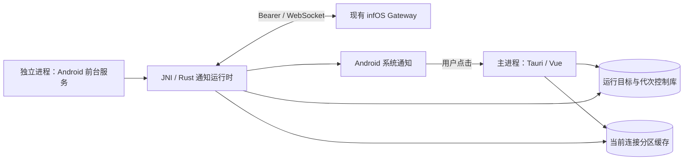

# Android 原生远程通知接收

本轮仅修改 PeroperoChat，未修改 infOS。实现的是不依赖 Google 服务的原生后台直连，不包含厂商推送、FCM、UnifiedPush 或 iOS APNs。尚未经过 Android 编译、发布压缩或真机验收。

## 手机端结构



- `RemoteNotificationService` 运行在 `:remote_notifications` 进程，不创建 Activity、WebView、Vue、Live2D 或本地 Agent。
- Rust 接收器使用当前线程 Tokio 运行时。网络请求、实例身份核验、运行门与通知落盘都不依赖 Tauri `AppHandle`。
- 连接设置提供「后台接收」开关，默认关闭。开启前请求系统通知权限；提供通知设置、电池优化设置和当前连接状态。
- Android 14+ 声明 `specialUse` 前台服务类型及用途；用户开启后保留低重要性的连接通知。未使用有时长上限的 `dataSync`，也未通过播放静音音频等方式保活。若未来上架 Google Play，仍须按实际用途完成前台服务申报与审核。
- 接收进程通过 Android Keystore 解密凭据。密文位于 `noBackupFilesDir/remote-credentials/{credentialId}` 的原子文件；旧 SharedPreferences 密文在成功读取后迁移，密钥别名与加密格式保持兼容。凭据不经 Intent 或前端传递。

## 现有服务端协议

1. 使用保存的端点与凭据请求 `GET /api/distributed/identity`，核对 `serverId`。保留部署路径前缀，不跟随重定向，不关闭 TLS 校验。
2. 读取当前连接分区的 `preferences.principal`。首次没有选择记录时通过 `GET /api/agents` 发现可用角色，不硬编码 Pero、Nana 或其他角色 ID。
3. 携带 `Authorization: Bearer ...` 连接 `/ws/gateway`。
4. 发送协议版本 1 的 `hello`，使用 `ppc-notifier-{installationId}-{profileId}` 节点身份，与界面 Gateway 节点区分。平台声明为现有协议认可的 `android / native`，不申请输入席位，不提交聊天、审批、工具或已读操作。
5. 校验 `hello_ack` 的版本与 `audience-v1`。只处理 `push / durable_notification`，其他业务事件不会转换为系统通知。

当前使用的通知信封示例：

```json
{
  "protocolVersion": 1,
  "type": "push",
  "id": "事件身份",
  "payload": {
    "action": "durable_notification",
    "principalId": "当前角色身份",
    "notificationId": "持久通知身份",
    "revision": 1,
    "title": "通知标题",
    "body": "通知正文",
    "level": "info",
    "createdAt": "2026-10-21T00:00:00.000Z",
    "replayed": false
  }
}
```

沿用现有 Gateway 握手后补发未读持久通知的能力。暂不增加服务端接口、不把易失 WebSocket 序号当成跨服务端重启的持久通知游标。角色选择变化后重建后台连接；当前范围是**所选角色**，不是全部角色。

## 恢复、展示与隔离

- 心跳每 15 秒发送，45 秒没有入站活动则重连。网络重连采用带随机抖动的指数退避，最长约一分钟。
- 认证失效、实例身份变化和协议不兼容会持久阻止自动重试，打开连接设置处理后可明确重试；原连接重新授权后清除该阻止状态。
- 每两秒核对持久运行目标、代次、开关和凭据期限。每次通知落盘、显示及点击也校验运行门，切换期间拒绝旧回调。
- 模式切换先闭门并停止远程服务，再激活目标；独立模式的闹钟接收器继续使用独立运行门。开机、解锁、安装更新和系统重建服务仅恢复已启用的活动远程目标，不自行切换模式。
- 界面以有限期可见租约结合系统主进程可见性抑制重复横幅；主进程突然退出时不会仅凭残留租约吞掉新通知。
- 通知仍缓存到当前分区的 `notifications` 表，最多保留最近 256 条；`notification_receipts` 分开保存系统展示版本与明确已读版本。已读墓碑防止旧补发重新进入收件箱。
- 只有用户明确标为已读才沿用已有 `gateway.notifications.ack`。系统显示、点击或清除横幅不确认业务已读；历史补发采用静默通知。
- 点击通知打开远程收件箱并定位记录；不自动切换角色、实例或模式。点击在 Tauri 冷启动更新代次前核验，允许一次相邻冷启动交接，不能跨模式往返复用。当前服务端通知缺少统一业务对象定位字段，因此尚不能据此可靠直达某个会话或任务。

## 后续 infOS 接线参考

现有持久通知可以先兼容接收。要扩展为完整的移动设备通知能力，服务端后续需要明确：

- 通知专用客户端的能力协商、设备授权和订阅范围，避免按完整界面推送无关事件。
- 一台设备订阅多个角色的机制，保持角色授权边界，避免通过不停切换 principal 模拟全角色实时接收。
- 哪些事件产生持久通知：普通回复、主动消息、任务完成或失败、待审批等应由服务端业务规则决定。客户端不会从工具日志自行猜测通知。
- 统一的业务对象引用、修订、撤回或过期字段；当前客户端只消费已支持字段，新增字段需再同步移动端解析与跳转。
- 投递、设备接收和用户已读分别建模；多个设备的去重、未读同步及过期清理规则。

这些是后续扩展点，不代表本轮已经新增了服务端合同。当前适配不要求另外部署推送服务器。

## 验证边界

Rust 用例覆盖默认关闭、旧代次拒绝、认证阻止保持、前台抑制与已读分离、通知重放去重、冷启动点击交接及模式往返失效，并通过本机模拟 HTTP / Gateway 验证部署前缀、Bearer、独立节点握手和无已读／输入席位副作用。

本轮执行 `cargo test --manifest-path src-tauri/Cargo.toml --lib`，77 项通过、0 项失败。未运行前端测试、ESLint、单独构建、Tauri 启动或 Android / iOS 打包；未修改、启动或测试 infOS。

Android 的 Kotlin 桥接、Keystore 跨进程迁移、系统重建服务、真机功耗、Doze、厂商自启动策略及通知点击仍需实际验收。前台服务不自动豁免 Doze；手机限制后台、强行停止、网络不可达或 infOS 未运行时，不承诺实时投递。iOS 当前仅保留应用在线接收。
