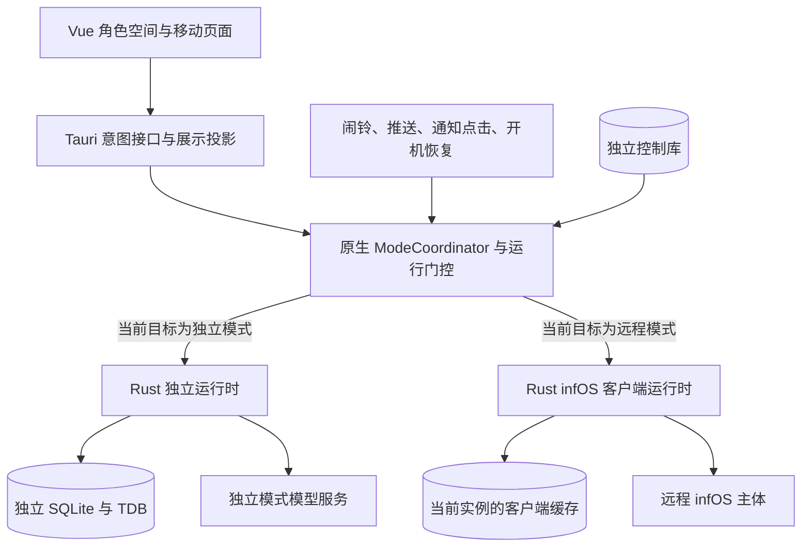

# PeroperoChat 双模式设计与 infOS 远程客户端实装规划

后续源码进展（2026-10-18）：手机远程界面已接线，默认恢复上次会话，角色迎接区按阅读场景收起；按用户要求，独立房间中的远程连接入口暂时关闭并显示「暂未开放」，已有实现保留。当前实现、持久化边界及尚待运行验收的范围见 [实装记录第 9 节](REMOTE_CLIENT_LOGIC.md#9-手机远程界面)。下文阶段清单保留规划与验收口径，不能将界面接线等同于全部阶段已经验收。

日期：2026-10-17

状态：设计与实施规划；原生与前端逻辑层已开始实施，用户界面及平台集成尚未验收。

范围：PeroperoChat 独立模式、infOS 主体客户端模式及必要的 infOS 服务端配合。所有子应用均不纳入本轮规划。

本文记录前期讨论、当前源码调查、设计约束、功能取舍和实装顺序。它不代表相关能力已经完成，也不授权执行测试、构建、打包、部署或发布。

## 1. 决策状态

| 类别 | 内容 |
| --- | --- |
| 已确认 | 两种模式定位独立；独立模式可脱离 infOS 运行，人设、记忆与其他业务数据不互通 |
| 已确认 | 远程模式必须连接 infOS，执行与数据权威归远程实例；本机不另行运行一个 infOS |
| 已确认 | 包括应用关闭时，同一安装实例最多只有一套业务运行体系有效 |
| 已确认 | 排除所有子应用；旧话题入口移除；新版远程模式完成前保持“暂未开放” |
| 已确认 | 前端负责展示与交互；独立模式业务在 Rust，远程模式业务在 infOS 服务端 |
| 已确认 | 延续角色陪伴空间、二次元视觉和轻量萌动反馈，不使用 emoji 图标或猫爪元素 |
| 范围建议 | 远程核心承接会话、待处理交互、任务、资源和据点；记忆与知识提供轻量管理 |
| 待评审 | 精确导航布局、远程角色资产适配、语音范围、移动系统推送渠道、参数修改作用域 |
| 待验证 | 目标 infOS 版本的真实协议兼容性、请求恢复、权限与多客户端交互、手机关闭后的通知行为 |

“最多一套”允许切换或恢复过程中暂时零套运行，不允许两套短暂并行。该约束作用于 PeroperoChat 本机；远程 infOS 及其其他客户端继续独立运行。

## 2. 两种模式的产品定位

### 2.1 独立模式

- 本地陪伴与轻助手，以纯聊天为主，保留现有五个小工具。
- 直接调用用户为独立模式配置的模型服务。此服务可以在云端或局域网，“本地模式”不等于所有模型推理都在手机上完成。
- 人设、用户资料、对话、提示词、TDB 日记、角色状态、提醒与外观偏好属于独立模式。
- 不向 infOS 上传独立模式历史、日记、凭据或角色定义，不自动导入远程数据。
- 当前日记继续采用 TDB 日期与文本检索，不增加向量检索或复杂工具体系。

### 2.2 infOS 客户端模式

- PeroperoChat 作为用户所选 infOS 实例的移动客户端。
- LLM、工具执行、上下文编译、记忆检索、任务和提醒调度由该实例负责。
- 本机负责连接、受限缓存、媒体呈现、输入与文件传输、原生通知及设备交互。
- 同名角色在两种模式中是不同数据归属，不能因 `agentId='pero'` 相同而共用状态。
- 远程工具能力继续受服务端会话模式、配置、权限和审批规则约束；客户端不绕过门控。
- 本轮排除子应用。客户端不建立应用目录、子应用容器或子应用协议适配。

### 2.3 关闭、断线与切换的含义

| 操作或状态 | 含义 |
| --- | --- |
| 关闭页面或应用进程 | 当前模式保留；平台后台入口仍按该模式判断是否允许执行 |
| 远程断线 | 仍为远程模式，显示离线；不自动启用独立模式或切到其他服务器 |
| 退出远程模式 | 本机停止旧远程运行时、订阅与通知资格，不停止整个 infOS |
| 切换远程实例 | 一次完整的运行目标切换，旧实例请求、缓存投影、输入凭据和回调失效 |
| 暂停独立模式 | 保留独立业务数据，停止请求、业务定时器及系统提醒登记 |
| 恢复独立模式 | 重新读取其数据并对账系统调度，不恢复旧请求的执行权 |

远程任务已经被服务端接受后，不因手机切换模式而默认取消。需要取消时，用户对明确的任务或执行发出取消操作；本机断开传输不等于服务端回滚。

## 3. 当前实现基线与缺口

### 3.1 PeroperoChat 已有内容

- Rust 独立会话服务、取消与终态、四类模型协议、有界 ReAct、提示词管理接口和 TDB 日记。
- 独立模式五个工具：`write_diary`、`query_diary`、`update_character`、`query_reminders`、`manage_reminder`。
- Android 系统提醒：SQLite 调度待办、AlarmManager、Receiver、JNI/Rust 认领与确认、恢复对账。
- 角色房间、折叠聊天、衣柜、日记、提醒、设置及新家庭群聊界面。
- 远程入口已禁用，应用根组件不再挂载旧远程页面；旧模式缓存不再决定启动页面。

### 3.2 规划编写时的关键缺口（历史基线）

下列内容记录实施前的状态，不能作为当前代码状态的断言。2026-10-17 的逻辑层实装进度、IPC 和剩余边界见 [双模式逻辑层实装记录](REMOTE_CLIENT_LOGIC.md)。第 13 节的勾选以完整阶段验收为准，已有代码但尚未完成平台或端到端验证的项仍保持待验收。

- 没有原生持久化 ModeCoordinator、跨入口运行代次、模式切换事务与崩溃恢复日志。
- 独立模式数据库初始化、后台对账与 Receiver 尚未统一经过模式运行门控。
- `src/api.js` 中旧 `appMode`、`remote_config` 和相关页面不能作为新版运行权威或协议实现。
- 前端启动仍按独立角色链路恢复，尚未实现“先读取原生运行目标，再恢复对应角色与会话”。
- 没有新版 infOS 的完整 Rust 远程传输、投影缓存和移动交互适配。
- 未发现已接入的移动系统远程推送链路；Gateway 在线通知不能直接证明关闭应用后的通知可用。

上述基线下仅有远程功能关闭的独立应用。新增控制层已有 Rust 隔离测试，但仍不能把代码实装等同于移动平台与完整远程模式已验收。

### 3.3 可复用的 infOS 主体基础

当前主仓库已有 REST API、聊天 SSE、Gateway WebSocket、Conversation/Task/Stronghold Projection、Surface、审批、问题组、持久通知和 Input Seat。

Gateway 实现声明 `surface-v1`、`audience-v1`、`cursor-v1`、`input-seat-v1` 等特性。Surface 源码注明属于 infOS 内部协议；接入应建立明确兼容范围和契约验证，不能把它当作跨版本永久稳定的第三方 ABI。

源码中存在部分旧 DTO、注释与当前实现不完全一致的情况。协议清单以目标版本实际 Router、校验器、Projection 和运行行为为准，不照抄旧客户端封装。

## 4. 核心架构与职责



| 层 | 职责 |
| --- | --- |
| Vue | 输入草稿、导航、选择、渲染、动画、媒体交互，不持有业务真相 |
| ModeCoordinator | 当前运行目标、代次、切换状态、入口鉴权、活动运行时生命周期 |
| 独立 Rust 运行时 | 现有模型请求、上下文、ReAct、存储、日记与提醒业务 |
| 远程 Rust 运行时 | 连接、认证、协议适配、SSE/WS、上传下载、事件校验、有界缓存及恢复 |
| Android/iOS 平台层 | 系统回调、通知与设备能力，只接受当前目标有效的调用 |
| infOS | 远程角色、会话、工具、任务、记忆、知识、据点与权限的权威状态 |

优先分别实现两套服务与 Store，复用品牌图标、头像、气泡等纯展示组件。不要用一个不断增加 `if (remote)` 的通用业务 Store 混合两种语义。

## 5. 持久运行目标与代次

拟在原生控制库保存下列最小信息，字段名为设计建议：

```text
installationId          当前安装的身份；重装或控制库重建后更新
selectedTarget          用户最后选择的目标：独立 / 指定远程配置
activeTarget            当前实际具有业务执行权的目标；可为空
activationEpoch         单调递增的运行代次
phase                   stable / quiescing / deactivating / activating / recovery_required
switchId                当前切换操作的稳定身份
previousTarget          恢复诊断使用，不代表自动恢复执行权
targetProfileId         远程配置的不透明标识，不包含凭据
notificationGeneration  通知订阅和原生动作的有效版本
lastError               可展示的切换或恢复错误，不含秘密
```

- 原生控制库是唯一权威，Vue/localStorage/SharedPreferences 的副本都不能单独授予执行权。
- 每个请求、事件、回调、后台任务和通知动作携带当前运行令牌。
- 运行令牌至少绑定安装身份、目标、代次；远程令牌额外绑定服务器和认证范围。
- 不使用墙上时钟判断新旧，不把 WebSocket 连接代次、Surface generation 或 Input Seat epoch 当作应用模式代次。
- 在稳定远程模式下，连接可以是 `offline/connecting/online/reconnecting/auth_required/incompatible`，不因此改变选中模式。
- 控制状态缺失、损坏或处于未完成切换时，后台执行默认拒绝；前台进入明确恢复流程。

### 5.1 多入口并发与提交门控

ModeCoordinator 需要覆盖 Tauri 进程、冷启动 Receiver/JNI、推送入口等实际运行边界。不能假定所有入口永远共享一个内存 Mutex。

切换和以下短临界操作必须使用一致的序列化机制：业务提交、提醒认领/确认、原生通知展示、输入回答及其他本机副作用。持久代次检查须在产生效果的临界边界执行，不能只在请求开始时检查一次。

约束如下：

1. 旧代次可在切换门关闭前完成提交；门关闭后不得再提交或展示通知。
2. “检查通过 → 切换完成 → 旧任务通知展示”的竞态必须由原生门控消除。
3. 网络、模型调用和插件等待不长期占用控制锁；只在短边界重新验证并提交。
4. 统一锁顺序及桥接调用规则，避免持有数据库锁等待会重新访问数据库的原生插件。
5. 跨数据库、系统调度和网络没有统一事务，使用持久切换日志与幂等对账恢复，不声称一次写入即可原子完成所有动作。
6. 已发送的远程请求可能继续在服务端执行。代次隔离阻止迟到结果污染本机，不能撤销已经发生的远程效果。

门关闭后的独立请求终态清理由 ModeCoordinator 以 `switchId` 授予的受限清理权限完成：只结束已登记请求、释放租约并记录取消，不提交旧回复、日记、角色变更或提醒草稿，不展示通知。不能为了写入取消终态重新开放旧运行门。

## 6. 数据、凭据与缓存隔离

### 6.1 存储归属建议

```text
应用私有数据目录/
  data/control/runtime.sqlite             模式控制与切换恢复，不保存业务正文
  data/peropero.db                        现有数据库，归独立模式专用
  data/diary/...                          现有 TDB，归独立模式专用
  data/remote/{partitionId}/client.sqlite  指定远程身份的投影缓存与传输状态
  data/remote/{partitionId}/assets/...     该范围内的媒体与临时文件
```

先保留独立模式现有路径，避免同时改变 JNI 数据库定位和存储布局。物理路径名不必叫 `standalone`，但其访问权必须归独立运行时。后续如需迁移路径，应使用独立的可恢复迁移流程。

远程分区由经核验的 `serverId` 和认证范围确定；同一服务器下的不同账号或授权范围不默认共用缓存。若服务端尚未提供稳定认证主体，先使用独立配置分区，不自行推断两个凭据属于同一个人。

### 6.2 对象引用

跨界面引用至少保留：

`mode + partitionId + serverId + agentId + threadId/roomId/taskId/resourceId`

异步请求再附带模式代次、请求身份与资源修订。审批/回答附带服务端要求的 Surface generation、Input Seat 等凭据。展示名称不能作为身份。

### 6.3 必须分开的数据

角色定义、用户资料、提示词、模型配置与密钥、消息与草稿、日记与记忆、提醒、任务、未读、通知去重、资源缓存、最近页面及当前角色/会话都按模式和远程分区保存。

- 远程缓存只保存客户端所需投影，不复制 infOS 的 SQLite/TDB，也不运行本地远程记忆检索。
- 非当前分区不启动业务连接、定时刷新、索引或消息恢复。
- 凭据迁移到平台安全存储，前端只获得存在标记和用户需要编辑的受限信息。
- 旧 `remote_config` 仅作为待迁移配置来源；不因存在旧 token 就自动连接或启用远程。
- 备份、导入、重置、退出登录和清缓存区分作用范围；独立备份不能覆盖控制代次或远程凭据。
- 恢复独立备份、切换认证范围及重装后重新产生运行/通知身份，旧回调不能复活。
- 本地 UI 外观可以共用展示资产；角色状态、业务配置与远程资产映射仍分开。

## 7. 模式切换流程

### 7.1 标准切换

1. 校验目标配置及协议可用性；仅连接探测不授予新运行时业务执行权。
2. 单写者记录切换意图，递增代次，关闭旧运行门，进入 `quiescing`。
3. 独立运行中的模型请求发出取消，等待取消与协调器受限终态清理；远程停止本机流和订阅，记录状态不确定的已提交请求。
4. 按原分区保存可恢复的界面草稿，卸载旧 Store 与角色投影，释放 Input Seat 和旧会话订阅。
5. 撤销旧模式的系统登记、恢复任务与通知资格，清理旧模式已显示通知及其点击动作。
6. 持久化旧目标已停用；此时可以暂时没有活动运行时。
7. 创建目标分区服务，恢复对应角色/会话，进行权限和调度对账。
8. 目标准备成功后发布 `activeTarget`，进入 `stable`，向 UI 发出一次完整状态投影。

任一步失败时保留切换日志与明确错误，不并行启动另一套业务来掩盖问题。无法证明旧运行时已失效时，新运行时不得获得执行权。

### 7.2 失败与重启

- 在任意切换阶段杀进程，下一次启动先读取控制日志；后台回调先拒绝未稳定状态。
- 恢复首先清理旧目标残留登记与句柄，再继续目标激活或呈现恢复入口。
- 不静默回退到独立模式。用户明确选择返回原目标时，也产生新的代次。
- 新旧服务器、凭据和目标全部保留明确归属；旧服务器撤销通知订阅失败时，以本机拒绝旧通知兜底。
- 非活动远程实例的补偿请求不维持后台业务连接；需要重连时按明确的管理或激活流程处理。

### 7.3 独立提醒的休眠与恢复

- 切出独立模式撤销 AlarmManager 登记及恢复闹铃，停掉进程内对账；保留业务提醒记录。
- 不能通过把提醒写成已送达或业务删除来实现模式停用。
- 模式代次加入闹铃与重试回调验证；Receiver 即使被系统唤醒，也只做共享门控检查后退出。
- 恢复独立模式后按当前时间重新计算调度。过期一次性提醒如何摘要提示、重复提醒如何推进须有明确规则；不逐次补发所有错过周期。
- 默认建议：过期一次性项汇总到待查看记录，重复项推进到下一个未来周期；具体规则在实施前评审，并与现有补发行为区分。

首次安装由前台创建明确的默认独立目标；旧版本升级先建立控制库与新代次，再恢复独立模式。控制库尚未建立时，升级后的后台入口默认拒绝，不能根据遗留的闹铃缓存猜测活动模式。

## 8. 应用关闭后的隔离与远程通知

### 8.1 原生入口矩阵

| 入口 | 独立模式有效 | 远程模式有效 | 切换/损坏状态 |
| --- | --- | --- | --- |
| 本地提醒 Receiver 与 JNI 执行 | 校验代次后允许 | 拒绝 | 拒绝 |
| 本地开机、校时、权限恢复对账 | 允许独立恢复 | 不登记独立任务 | 只恢复控制状态 |
| 远程业务连接与重连 | 不启动 | 只连接选中实例 | 不启动业务连接 |
| 远程推送消息 | 不展示、不进入业务缓存 | 核验目标后处理 | 不展示 |
| 通知点击、通知按钮、深链接 | 只接受当前范围 | 只接受当前范围 | 打开恢复界面，不执行业务动作 |
| 分享、外部文件入口 | 路由到当前独立身份 | 路由到当前远程身份 | 仅暂存入口意图，待恢复后选择 |

后台唤醒共享的最小门控入口不代表启动了非活动模式。旧来源不能启动 LLM、读取非活动业务库、刷新其状态或弹出通知。

### 8.2 远程通知契约建议

通知至少绑定实例、认证分区、设备安装、订阅代次、通知 ID/修订、目标对象及过期时间。令牌与正文不写入诊断日志。

- infOS 维护与当前激活绑定的设备通知订阅；切换、退出登录与凭据撤销时注销或失效。
- 本机在通知展示前重新读取原生模式门，不仅依赖服务端及时撤销。
- 按稳定通知 ID 与修订去重，在线 WS 与系统推送汇入同一通知处理器。
- 手机被杀后重连，应从服务端 Projection/持久通知恢复实际状态；推送正文不是业务权威。
- 拒绝的旧范围通知不得标记为用户已读，也不得通过点击动作自动切换模式。
- 通知展示回执、用户已读、业务审批三个动作分别定义，不能互相替代。

当前尚未确定推送渠道，也没有完整的移动离线推送实现。实装时需要验证 Android/iOS 的通知展示路径：若通知绕过应用原生门控自动展示，服务端注销不能消除已在途消息的隔离竞态，该方案不能满足严格要求。

严格隔离优先。无法保证展示前门控的平台或渠道，先提供在线通知与重连恢复，并明确关闭状态通知不可用；不得以“基本能用”宣称满足关闭状态隔离。关闭、系统强制停止、权限关闭及厂商限制分别验收，不承诺所有情况必达。

远程模式不把服务端提醒再登记成本机独立提醒，不依赖长驻 WebSocket 证明退出后的系统通知已实现。

## 9. 远程功能范围与优先级

本节为基于主应用调查形成的范围建议，后续 UI 评审可调整呈现位置。

| 功能 | 优先级 | 移动端范围 |
| --- | --- | --- |
| 实例连接、认证、角色与会话身份 | 核心 | 实例列表、显式切换、连接状态、协议错误与恢复 |
| 角色陪伴空间 | 核心 | 远程名称、头像、状态、台词、主动活动；表现使用明确资产适配 |
| 会话与聊天 | 核心 | 历史分页、新建/切换、正文、思考、工具状态、附件、停止、重生成与消息管理 |
| 聊天/工作及执行模式 | 核心 | 展示服务端当前策略，必要切换走权威接口，不因手机入口改变权限 |
| 审批、提问、待处理交互 | 核心 | 多题回答、必要参数/影响预览、批准/拒绝、附言、来源跳转与过期处理 |
| 后台任务与行动计划 | 核心 | 派发、进度、结果、等待原因、暂停/继续/取消与重试；只提供服务端允许的动作 |
| 提醒、跟进、主动建议 | 核心 | 查询、取消、失败处理、接受/忽略建议、跳转原任务或对话 |
| 文件与任务产物 | 核心轻量 | 上传、浏览、搜索、文本/PDF/媒体预览、下载、系统分享 |
| 据点 | 核心 | 设施/房间选择、成员与环境摘要、消息和 @；后续可提供少量房间管理 |
| 事件记忆 | 次级 | 时间线、搜索、详情、来源、归档/恢复/删除；不复制图谱工作台 |
| 事实与文档知识 | 次级 | 保留两类结构，查询、来源、阅读与必要撤回/删除/上传 |
| 模型与参数 | 次级 | 显示当前模型与能力，按服务端真实作用域选择已有配置或调整必要参数 |
| 角色、用户资料 | 次级 | 查看与基础编辑；角色创建、人设深度管理不阻塞核心闭环 |
| 语音 | 次级 | 按住说话、识别与播报；缺少服务时明确降级，不复制供应商配置页 |
| 用量、天气、塔罗 | 可选 | 简短摘要或小入口，按投入与体验决定 |

基本不加入手机专用页面：完整代码工作台、多终端与浏览器标签壳、系统监控大屏、提示词调试器、能力矩阵、MCP 部署、索引与记忆算法调参、系统 Cron 运维、全量数据同步、数据库迁移与危险重置、桌面窗口和输入设备管理。

服务端仍可使用这些工具与能力。手机保留其必要交互和结果，省去低频管理界面。对话日志融入会话历史，总览中的待处理内容融入角色空间和活动入口。

## 10. UI/UX 组织建议

### 10.1 共享视觉与明确归属

- 沿用现有角色房间、头像、线性 SVG 图标、品牌图标、气泡材质、抽屉和轻量过渡。
- 独立模式与远程模式共用视觉语言，分别维护页面数据与状态。
- 远程界面持续显示实例身份及连接状态；模式切换是明确入口，不能藏在普通模型设置里。
- 角色房间属于陪伴入口，长对话、待处理表单和任务结果进入适合阅读的界面。
- 远程离线显示该分区最后一次快照和时间，禁止伪装在线；不使用独立状态填补空白。

### 10.2 建议信息范围

| 范围 | 页面组织 |
| --- | --- |
| 角色空间 | 当前角色、短消息、心情、活动摘要与常用入口 |
| 会话 | 当前对话、历史列表、模式与工具策略、资源引用 |
| 待处理与任务 | 待回答/待审批优先，活动任务、提醒、历史结果随后 |
| 资源 | 由对话或任务进入预览，也提供轻量文件浏览 |
| 据点 | 房间列表进入房间消息，成员与环境使用抽屉 |
| 记忆与知识 | 次级列表与详情，保留来源回跳 |
| 设置 | 连接配置、本机通知/外观、有限远程设置；明确影响本机还是服务器 |

以上是信息结构，不固定为七个底部 Tab。最终导航在核心页面原型评审时确定，避免先按桌面菜单数量决定移动布局。

### 10.3 必须闭合的导航链路

1. 通知 → 当前实例校验 → 原会话/任务 → 待处理表单 → 权威结果刷新。
2. 对话 → 关联任务 → 执行结果 → 附件/工作区产物 → 返回原位置。
3. 记忆/知识 → 来源 → 原对话或资源；来源已删时明确显示不可用。
4. 据点房间 → 消息 → 发言角色/关联资源；内部 group Thread 不作为用户房间列表。
5. 过期通知或其他模式深链接 → 说明来源失效，不自动切换、不执行旧动作。

所有路由与弹层携带对象归属。切换实例、角色或模式时作废旧页面异步结果，按新分区恢复草稿与导航位置。

## 11. infOS 协议与接口对接清单

下列路径来自当前源码，仅作为调查基线，最终以选定版本的实际契约为准。

| 领域 | 现有入口 | 接入要点 |
| --- | --- | --- |
| 实例身份 | `/api/distributed/identity` | 校验稳定 serverId；不调用完整同步接口 |
| 角色与状态 | `/api/agents`、角色详情、`pet-state`、`texts`、`companion` | 角色选择是客户端状态，按明确角色读取 |
| 会话 | `/api/chat/threads`、`projection`、工具/交互/执行模式接口 | 按游标读取，保留修订和身份 |
| 聊天执行 | `/api/chat`、`/api/chat/stream`、`/api/chat/stop` | 处理 SSE Surface 与终态，不解析正文标签执行工具 |
| 实时同步 | `/ws/gateway` | 版本协商、订阅、游标、心跳、重连、Input Seat |
| 人类交互 | `/api/surfaces/input`、审批/提问查询 | 绑定正确对象、generation、seat 与 epoch |
| 后台任务 | `/api/background-tasks`、详情/投影/控制接口 | 服务端状态驱动按钮；暂停/恢复等能力逐项核实 |
| 行动计划 | `/api/task-plans` | expectedRevision；清计划不取消任务 |
| 提醒与建议 | `/api/scheduler/activity`、用户提醒与建议接口 | 与系统维护任务列表分开 |
| 记忆与知识 | `/api/memories`、`/api/knowledge` | 来源、归档/撤回、删除及异步清理状态 |
| 资源 | `/api/attachments`、`/api/workspace` | 鉴权、Range、版本、下载与身份范围 |
| 据点 | `/api/stronghold` | roomId 是房间权威消息边界 |
| 语音 | `/api/voice` 与 Gateway 音频 | 单独核验认证、格式与目标设备路由 |

### 11.1 有待 infOS 配合的契约

- TODO：确定并固定兼容版本、特性发现、错误结构与兼容诊断，不能只比较产品版本字符串。
- TODO：核对请求幂等与状态查询。当前聊天 DTO 未提供完整的移动请求恢复合同，不能假定重连重发安全。
- TODO：明确服务器身份、认证主体、设备身份及凭据撤销语义。
- TODO：按实际投影验证多题交互、审批、持久通知与 Input Seat 的跨客户端行为。
- TODO：形成移动推送的注册、失效、订阅代次、回执、重放与投递状态合同。
- TODO：核对资源接口在远程鉴权、媒体流和实际部署前缀下的可达性，不把远端 localhost 路径交给手机访问。
- TODO：核对模型与必要参数修改的真实作用域；全局修改不得伪装成只影响当前手机或会话。
- TODO：移除接入范围内对 Electron IPC 或服务器文件系统本地路径的隐式依赖。

缺口需要形成明确的 infOS 变更项，不在 PeroperoChat 中模拟服务端事实。

## 12. 远程执行、渲染与恢复规则

### 12.1 传输与权威读模型

- 远程网络和凭据生命周期由 Rust 管理；Vue 通过 Tauri 提交意图、消费受限 DTO。
- REST/Projection 用于恢复实际状态，SSE/WS 用于增量和刷新提示，不另造权威消息数据库。
- 明确每类事件使用的通道，在线事件和重连快照合并去重，避免 SSE 与 WS 重复渲染同一内容。
- 保留 serverId、分区、agentId、threadId、executionId、requestId、revision、sequence、generation 的原始含义。
- 历史、任务、文件和记忆分页查询，缓存有界；不一次性下载全部远程数据。

### 12.2 Surface 呈现

核心至少支持正文、代码/数学等富文本、原生思考、工具调用/结果、附件、状态、错误、进度、审批和提问。

- 工具卡片只显示服务端记录，不在手机执行工具 JSON。
- 工具参数和危险动作保留足够的说明，不把所有工具结果当普通台词覆盖角色气泡。
- 未支持的节点明确降级或提示不兼容，不静默丢掉审批和必答问题。
- Programmable Island 等可执行表现节点本轮不直接运行；目标服务器若会发出此类节点，需协商关闭或提供只读替代。
- 角色心情与任务执行状态分别显示，不把错误、等待审批或断线推演成角色心情。

### 12.3 请求状态不确定

- 每次写请求有稳定客户端身份，发送前保存最小待处理记录，不能靠用户消息文本判断是否重复。
- 服务端支持幂等与查询后，以同一请求身份核对结果；不能重新生成身份自动重复派发。
- 无法判断是否被接受时，显示“状态待确认”，先读快照或查询，不自动重发计费/写入请求。
- 网络 EOF、超时与页面离开不等同执行失败，更不等同未持久化。
- 模式切换后旧响应不写入当前业务或 UI；必要的请求诊断只留在原归属的最小控制记录中。

### 12.4 交互与文件

- 审批、任务问题组提交前读取最新状态，确认其仍待处理；另一客户端已回答时刷新为已解决。
- 输入席位按实际要求获取/续约/释放，失效不能用客户端当前角色替代服务端请求归属。
- 任务只读查看与取结果不默认取消、重启或取得整个任务的独占控制权。
- 上传、下载与系统分享均绑定目标分区和资源版本，取消或切换后不把文件送到另一个实例。
- 工作区当前文件、附件副本与任务产物区分展示；文件路径不是跨实例通用身份。
- 撤回按服务端预览结果说明消息与文件影响，不能沿用独立模式“删除一轮”的固定文案。
- 本轮不建立离线编辑同步引擎。离线可保留草稿和缓存阅读，远程写入待在线明确提交。

## 13. 分阶段实装流程

### 阶段 0：锁定范围与协议基线

- [ ] TODO：确定目标 infOS 版本和本轮功能清单，排除所有子应用。
- [ ] TODO：整理实际 Router、请求校验、Projection 与协议样例，记录待修复合同。
- [ ] TODO：列出当前所有启动、计时器、JNI、Receiver、通知及深链接入口。
- [ ] TODO：确认平台范围，分别标记 Android、桌面与 iOS 的交付和验收要求。

完成条件：输入输出、身份、错误、分页、恢复和后端缺口清晰；远程入口继续关闭。

### 阶段 1：先建立双模式互斥底座

- [ ] TODO：实现原生控制库、运行门、代次与可恢复切换日志。
- [ ] TODO：将启动改为先恢复控制状态，再创建唯一活动运行时。
- [ ] TODO：接入独立请求、提交、后台轮询、闹铃与 JNI 的门控。
- [ ] TODO：实现系统登记撤销、旧通知动作失效、独立提醒休眠与恢复。
- [ ] TODO：完成数据分区、原生凭据存储与旧配置迁移，保留现有独立数据库路径。

完成条件：即使远程尚未实现，也能证明切到非独立目标后独立执行不会被任何冷启动入口恢复。故障状态可恢复且不并行运行。

### 阶段 2：远程连接、会话与读模型

- [ ] TODO：实现 Rust 连接配置、实例身份校验、认证和协议适配。
- [ ] TODO：实现分区 Store、远程角色与会话列表、历史 Projection、有界缓存。
- [ ] TODO：接入聊天 SSE、Gateway 订阅、取消与重连恢复。
- [ ] TODO：完成基本 Surface 渲染与请求状态不确定处理；需要的幂等合同同步落到 infOS。
- [ ] TODO：基础上传、附件预览及工作区产物读取可用。

完成条件：选中实例的会话能够闭环，断线不重复发送，切换不串数据，也不启动独立模型服务。

### 阶段 3：待处理交互与任务闭环

- [ ] TODO：接入 Input Seat、多题提问与审批 Surface。
- [ ] TODO：提供跨角色的待处理列表，保留来源和失效状态。
- [ ] TODO：接入任务派发、行动清单、进度、结果与允许的控制动作。
- [ ] TODO：接入提醒、跟进与主动建议，统一错误和恢复呈现。
- [ ] TODO：通知、对话、任务、资源之间可准确跳转并返回。

完成条件：远程执行不会因手机缺少回答或批准入口而无法继续；多客户端抢先处理能够收敛。

### 阶段 4：应用关闭后的远程通知

- [ ] TODO：评审并实现服务端设备订阅与移动推送合同。
- [ ] TODO：原生推送入口接入同一控制门、目标校验、去重及点击路由。
- [ ] TODO：在线事件、离线通知和重连回放汇入统一处理器。
- [ ] TODO：验证在途旧推送、注销失败、重装、认证变化和系统强制停止等情况。

完成条件：所声明支持的平台具备展示前隔离；不支持或不可保证的状态明确降级。未达到此条件，不开放“关闭 APP 后可接收远程通知”的声明。

### 阶段 5：据点、记忆知识与移动体验

- [ ] TODO：接入远程据点的房间、成员、消息、@ 与环境摘要。
- [ ] TODO：接入事件记忆、事实与文档知识的轻量列表、详情和来源。
- [ ] TODO：必要模型/参数、用户与角色资料、语音按范围逐项接入。
- [ ] TODO：优化角色房间、任务与资源页面、长消息窗口化和媒体生命周期。

完成条件：本轮核心功能范围完整可用，次级能力按清单明确支持，不把未实现项伪装成完整管理界面。

### 阶段 6：验收、开放与发布

- [ ] TODO：按下节矩阵进行已获授权的自动与人工验证，保存真实记录。
- [ ] TODO：完成数据迁移、回退与失败恢复说明。
- [ ] TODO：移除或明确归档旧远程实现，清理 localStorage 模式与旧凭据链路。
- [ ] TODO：界面明确模式、实例、连接、后台通知支持范围；最后解除“暂未开放”。
- [ ] TODO：按用户另行授权更新版本、提交、tag、推送及发布。

阶段依赖：`0 → 1 → 2 → 3 → 4/5 → 6`。UI 原型可提前制作，但不能绕过阶段 1 对运行互斥的要求。

## 14. 验证与验收矩阵

以下是计划，本文编写期间不运行测试或构建。

| 类别 | 必须覆盖的场景 |
| --- | --- |
| 唯一运行时 | 两种稳定目标各只存在一个业务运行时；连续点切换不会双开 |
| 切换竞态 | LLM 处理中、事务提交、通知提交、Receiver 认领、上传和 WS 重连时切换 |
| 崩溃恢复 | 在切换各阶段杀进程；重启、开机广播、控制库不可读时不会双开 |
| 本地后台 | 远程模式收到旧闹铃、恢复闹铃、时区变化与权限广播，均不运行独立业务 |
| 远程后台 | 独立模式收到旧推送、通知按钮、深链接，均不展示或执行业务 |
| 多实例 | 两个实例有同名 Agent/Thread；延迟响应和媒体缓存不串用 |
| 认证 | 过期、撤销、切换账号/配置、重新配对，不泄漏前一个范围的数据 |
| 远程断线 | 断线、超时、EOF、服务重启、低于游标保留范围后恢复正确快照 |
| 请求恢复 | 发送前/后断网、响应丢失、重复回调、状态未知，不重复插消息或派发任务 |
| 多客户端交互 | 桌面先回答、手机先回答、Seat 过期、重复批准、多题修订后提交 |
| 任务 | 正常完成、暂停/恢复/取消、等待条件、失败与产物查看；以服务端实际状态为准 |
| 提醒与计划 | 切出不误删任务，恢复不过量补发，清计划不取消任务，通知不双份 |
| 资源 | Range、版本变化、撤回资源、过期授权、大文件取消与模式切换 |
| 据点 | roomId 与内部 group Thread 不混淆，切房间不串消息，@ 及重连投影正确 |
| 数据迁移 | 旧独立数据、旧 localStorage 配置、备份恢复、重装与清缓存不恢复旧执行权 |
| UI 与性能 | 手机长屏/横屏、安全区/软键盘、历史阅读、返回位置、减少动画和离屏媒体释放 |

验收分层记录：Rust 单元与集成、前端协议/组件、模拟服务契约、桌面运行、Android 真机、iOS 真机及系统关闭状态。模板解析或桌面测试不能替代移动系统通知验收。

可在明确授权下使用现有 `pnpm test` 与 Rust 测试入口，扩展模式门控、迁移、协议和切换故障测试。构建、启动、打包及设备测试需遵循当次用户授权，不因本规划自动获得许可。

## 15. 开放远程入口的最低门槛

1. 原生运行互斥、持久切换与冷启动门控完成，且故障路径通过验收。
2. 独立与远程业务数据、凭据、通知、草稿及缓存范围清晰。
3. 目标 infOS 版本有经过核验的连接、会话、投影和请求恢复合同。
4. 会话、待处理交互、任务与结果至少形成完整闭环。
5. 据点、资源及其他本轮承诺能力按范围验收，未支持节点能够明确处理。
6. 关闭状态通知只有在相应平台验证通过后才声明可用，严格隔离不降级。
7. 独立模式无回归，远程离线与切换失败不会误启用独立模式。

## 16. 实装前待定事项

| 问题 | 当前建议 |
| --- | --- |
| 首发平台 | 优先明确 Android 范围；桌面用于开发验证；iOS 不自动视为具有相同后台能力 |
| 同时连接的服务器数 | 可保存多个配置，仅选中一个实例具备业务执行权 |
| 手机角色模型 | 先映射可兼容的头像、台词和状态；远程 3D/Live2D 资源契约另行评审 |
| 远程关闭通知渠道 | 先完成展示前门控与协议评审，再选择渠道，不沿用独立闹铃模拟远程推送 |
| 错过的独立提醒 | 默认建议汇总一次性过期项、重复项推进未来；实施前确认体验 |
| 快捷模型/参数范围 | 遵守 infOS 实际作用域，不自行增加“本机专用”假配置 |
| 网络探测与凭据迁移 | 允许最小连接验证，不创建目标业务会话、不自动恢复旧远程运行 |
| 新 UI 导航 | 先评审核心页面与跨对象跳转，再决定底部导航数量与入口位置 |

## 17. 后续代码落点建议

以下均为待实现模块建议，不表示文件已存在：

- `src-tauri/src/mode/`：控制存储、运行门、切换协调、恢复与状态投影。
- `src-tauri/src/remote/`：服务器身份/凭据、REST/SSE/Gateway、协议 DTO、缓存、资源传输与通知适配。
- `src/services/mode.js`、`src/services/remote*.js`：受限 Tauri 命令封装。
- `src/stores/mode.js`、`src/stores/remote/`：显示状态与分区缓存，不接管远程业务规则。
- `src/components/remote/`：重新基于新合同实现远程消息、交互、任务、资源和据点展示。
- Android 原生入口：接入 ModeCoordinator 与模式代次，增加经过评审的远程推送和点击门控。
- infOS 主仓库：按第 11 节列出的合同缺口逐项修改，不牵涉子应用。

优先以“入口→身份→提交/展示边界”核对现有代码，再接业务页面。旧远程页面的 REST 字段、角色状态和消息模型不作为兼容权威。

## 18. 参考源码与相关文档

PeroperoChat：

- [独立模式架构](STANDALONE_ARCHITECTURE.md)
- [安卓系统提醒](ANDROID_REMINDERS.md)
- [陪伴空间界面](COMPANION_ROOM_UI.md)
- `src-tauri/src/local/runtime.rs`、`conversation.rs`、`reminder_dispatch.rs`、`reminder_jni.rs`、`reminder_platform.rs`
- `src-tauri/gen/android/app/src/main/java/com/peroperochat/mobile/` 中提醒桥接与 Receiver
- `src/main.js`、`src/App.vue`、`src/api.js`、`src/stores/agents.js`、`src/stores/conversations.js`

同级 infOS 主仓库调查入口：

- `packages/backend/src/database/schema.ts`、`routers/`、`projections/`
- `packages/shared/src/types/surface.types.ts`、`gateway.types.ts`、`kernel.types.ts`、`event-memory.types.ts`
- `packages/frontend/src/api/modules/`、`composables/gateway/useGateway.ts`、`components/compositor/ConversationSurface.vue`
- `packages/frontend/src/components/main/tabs/StrongholdTab.vue`、`WorkspaceTab.vue`
- `.docs/A09_AIOS_ARCHITECTURE.md`、`B09_THREAD_INTERACTION_MODE.md`、`B12_MESSAGE_RESOURCES.md`、`B13_TASK_PLANS.md`、`COMPLETION_ALERTS.md`

调查依据为 2026-10-17 本地工作区源码，包含尚未提交的改动，不把某个 Git 发布 tag 当作这些内容的完整证明。正式开发前重新锁定 infOS 版本与契约基线。

## 19. 规划编写记录（历史）

首次编写本文时只新增规划文档并补充 README 导航，未修改业务代码，未执行测试、编译、构建、打包、启动、提交、打 tag 或推送。后续已按用户授权开始实装逻辑层，实际完成与验证记录另见 [实装记录](REMOTE_CLIENT_LOGIC.md)，不据此提前开放远程界面。
