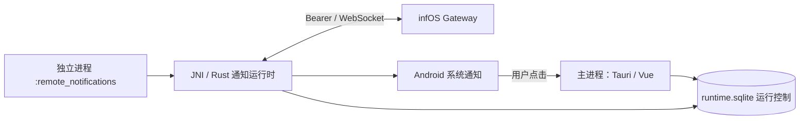

# infOS 远程客户端技术文档

在 infOS 客户端模式下，PeroperoChat 作为用户所选 infOS 实例的随身客户端运行：LLM 推理、工具执行、上下文编译、记忆检索与定时调度均由服务端承担，本机负责加密连接、受限投影缓存、流式富文本与文件交互、原生通知以及远程管理转发。

> 适用范围：不包含浏览器外跳任意网页与非受控通用 HTTP 代理；所有远程业务仅面向已配对的可信 infOS 实例。

## 1. 双模式定位与运行控制

### 1.1 模式隔离边界

| 维度 | 独立模式 | infOS 客户端模式 |
| :--- | :--- | :--- |
| **权威来源** | 全部业务在本地 Rust 执行 | 对话、任务与记忆以 infOS 服务端为准 |
| **数据归属** | 本机 SQLite 与 TriviumDB，不向远程上传 | 按连接 `profileId` 分区隔离存储 |
| **同名角色** | 与远程同名 `agentId` 数据完全隔离，互不共享 | 同左 |

核心不变式：**同一应用安装实例在任意时刻最多只有一套业务运行体系处于活跃状态**——模式切换期间允许短暂无活跃目标，但不会出现两套模式并行运行。网络断线时仍保持远程模式（界面呈离线态），不会自动切回独立模式；切换远程档案视为完整目标切换，旧连接请求、缓存投影与在途回调立即失效。

### 1.2 运行控制库（`runtime.sqlite`）

运行控制状态存储于应用私有目录 `data/control/runtime.sqlite`，核心投影字段如下：

```text
schemaVersion / revision / installationId / runtimeOwnerId
selectedTarget / activeTarget / activationEpoch
phase / switchId / lastError
```

目标格式为 `{ mode: 'standalone' }` 或 `{ mode: 'remote', profileId }`；每次请求、WebSocket 推送、回调、后台任务与通知动作均携带并校验活动令牌 `{ installationId, target, epoch }`。

- **单一运行权威**：原生控制库是唯一裁决源，前端内存或 `localStorage` 不可自行授予执行权。
- **串行切换与安全态**：`mode_switch` 按「关闭运行门并递增代次 → 通知前端 → 停止旧本地请求与远程观测连接 → 等待租约退出及受限清理 → 撤销系统登记 → 开放新目标」串行推进；若中途失败则置为 `recovery_required`（活动目标置空）。
- **并发与代次隔离**：控制操作、JNI 通知回调、桌面提醒及最终落盘统一通过短暂 `BEGIN IMMEDIATE` 控制事务协调（锁定顺序严格先于业务库）；WebSocket 游标、Surface `generation`、Input Seat `epoch` 与应用模式 `activationEpoch` 各自独立计数，严禁混用或依赖墙上时钟裁决新旧。

### 1.3 目录隔离、凭据保护与请求幂等

```text
应用私有数据目录/
  data/control/runtime.sqlite             模式切换控制与代次恢复（不存业务正文）
  data/peropero.db                        独立模式业务库
  data/diary/...                          独立模式 TriviumDB
  data/remote/{profileId}/client.sqlite   指定远程档案的投影缓存、传输与通知状态
  data/remote/{profileId}/assets/...      对应档案的媒体与临时文件
```

- **连接身份延续**：档案不允许直接改写远程地址，新增地址生成新 `profileId`。当服务端因 Docker 重建导致基于主机名派生的 `serverId` 变化时，仅当原设备令牌仍被服务端认可为同一未过期设备且核验前后实例编号一致，才原子更新实例标识与展示信息，保留原 `profileId`、凭据、草稿、阅读位置与请求墓碑。
- **平台凭据存储**：连接密钥分别托管于 **Windows DPAPI / Android Keystore / iOS Keychain**，不进入 Vue Store、Web Storage 或业务 JSON 备份；Android 云备份自动排除控制库、远程缓存、加密凭据与提醒调度缓存。
- **投影缓存配额**：正文投影最多保留 64 键 / 32 MiB（单条超 8 MiB 跳过缓存），对话/队列/任务投影独立拥有 64 MiB 配额；历史分页默认每次 24 条，触发大小预算时自动减半重读。
- **发送幂等与状态同步**：写请求发送前先落盘不含 `requestId` 的内容指纹，防止同内容未决期间重复创建新请求；重启或切换模式后，遗留的 `sending` 自动转为 `unknown` 等待人工或对账确认。原生错误携带 `outcome`（`not_sent` / `rejected` / `failed` / `unknown`）。
- **队列回执与断线核对**：聊天消息通过持久客户端 UUID 提交，接收回执以服务端队列快照为准；`remote_reconcile_request` 根据队列 UUID、持久 `pairId` 或 `messageId` 在前台定期同步断线后状态，重发复用同一 UUID 交由服务端队列去重。本机在回执前展示临时发送项并与正式消息关联，Surface 结算帧按代次与删除墓碑过滤延迟数据。
- **未知状态处理**：`remote_review_request`（保留兼容命名）支持一键忽略未知操作记录，备注可留空，同时兼容读取历史 `reviewed` 状态记录。

## 2. IPC 与前端服务

| 原生命令 | 用途 |
| :--- | :--- |
| `mode_snapshot`、`mode_switch` | 读取运行控制快照与提交模式切换（`src/stores/mode.js`） |
| 独立模式命令 + `modeToken` | 本地对话命令携带运行令牌校验身份（`src/services/localChat.js`） |
| `remote_profiles`、`remote_save_profile`、`remote_delete_profile` | 远程档案增删改查（不返回密钥；当前选中档案禁止删除） |
| `remote_query` | 受限只读数据查询，支持指定仅读取本地离线缓存 |
| `remote_action` | 携带稳定 `requestId` 的受限写意图转发 |
| `remote_chat` | 携带持久 UUID 向 `/api/chat/queue/:threadId` 提交对话消息 |
| `remote_connect`、`remote_subscribe` | Gateway 身份握手与事件流订阅，底层自动重连 |
| `remote_surface_input` | 根据请求主体身份认领输入席位并提交审批或提问回答 |
| `remote_pending_requests` | 查询当前分区待确认的写请求记录 |
| `remote_upload`、`remote_resource` | 原生鉴权附件上传与头像、媒体、带版本工作区资源读取 |
| `remote_ui_read`、`remote_ui_write` | 读写 `Home` / `Session` / `Character` 三类本机视图状态 |
| `remote_manage` | 管理配置与工作台命令转发（详见第 7 节） |
| `remote_notifications`、`remote_ack_notification` | 读取本地缓存通知与发送显式已读回执 |

新版主会话「保存并重新生成」按修订保存消息正文后，调用 `/chat/threads/:id/regenerate` 并持久化同一提交 UUID 以便安全重试；历史旧会话恢复沿用原路径兼容。所有远程命令及回调均携带当前 `modeToken` 与 `revision`，过滤跨模式或跨代次过期事件。

### 2.1 连接、配对与认证

- **三种登录路径**：`pair`（一次性配对码，默认）、`login`（管理凭据换取设备令牌）与 `bearer`（显式令牌兼容），不自动降级鉴权方式。
- **配对校验**：链接严格限定 HTTP(S) 的 `/#/app?pair=<10 位十六进制>` 格式，拒绝附带账号、重复参数或回环地址；局域网明文 HTTP 须用户在界面显式勾选授权，扫码由 Tauri 原生 `barcode-scanner`（前后端锁定 `2.4.6`）执行，配对码不写日志或 Web 存储。
- **会话令牌管理**：Rust 从 `Set-Cookie` 提取 `infos_device` 并核对 `/api/client-access/status` 与实例身份；令牌写入系统保护存储且不注入 WebView Cookie。未勾选「保持登录 30 天」时会话绑定当前进程生命周期，重启失效。
- **连接验证与复用**：强制标准 TLS 验证、禁用 HTTP 自动重定向、禁用 URL 凭据/查询/片段。相同运行代次与连接配置在 **10 秒** 窗口内复用一次 `serverId` 核验与连接池（认证或证书出错即刻清除缓存）；遇到 HTTP 401、凭据撤销或鉴权失败关闭 WS 时停止自动重连。`remote_logout_device` 仅注销当前设备会话，保留本机阅读记录与远端业务数据。

### 2.2 Gateway 订阅与输入席位

- **序列号补发与重连**：WebSocket 升级头携带 Bearer 鉴权（`hello` 帧不重传密钥）。Gateway 按流追踪当次运行 `sequence`，断线后采用带随机抖动的指数退避重连，依据真实游标拉取增量补发并去重；出现序列缺口、保留窗口过期或序号回退时主动全量刷新快照。
- **读票据与过期兜底**：缓存查询发起前取得持久化读票据，仅最新票据允许覆盖本地缓存；纯网络断联时允许读取带过期标记的旧缓存，但证书/实例变更时不启用此兜底。
- **输入席位（Input Seat）**：审批与问答按服务端交互请求归属角色抢占席位；若被其他客户端抢答、席位失效或 Surface `generation` 变更，服务端直接拒绝。业务提交仅在服务端明确返回席位丢失或未产生副作用时自动重新认领一次。

## 3. 界面导航与主题体系

远程模式入口位于独立房间菜单的「infOS 客户端」或 **设置 → 运行模式与远程连接**。底栏固定五个核心标签：**`首页`、`会话`、`任务`、`资料`、`管理`**；通知与审批收件箱从页头铃铛或首页直达。启动默认恢复上次远程会话，并优先读取当前分区的 Home 记录还原角色。

| 板块 | 核心内容与行为 |
| :--- | :--- |
| **首页** | 当前实例概况、连接状态、角色 CG/头像、上次会话快捷入口、服务端任务与当前工作区文件、通知概览 |
| **会话** | Surface/SSE 流式投影、历史分页加载、阅读位置记忆、原生输入草稿、队列操作、附件上传与停止生成 |
| **交互模式切换** | 极简 / 聊天 / 工作模式通过 `interaction_mode` 切换并重新拉取会话权威投影 |
| **执行与审批** | 紧凑折叠的思考过程与工具轨迹、关联任务、交互审批与问答确认 |
| **任务** | 按状态分页筛选与新建远程任务（结果未决时禁止盲目重复派发） |
| **资料** | 分类文件浏览、版本描述、独立记忆与文档检索及来源详情 |
| **管理与工作台** | 五大管理分组、Skills/插件/提示词/终端/据点等工作台能力（详见第 7 节） |
| **通知中心** | 持久待阅通知、显式已读回执、待审批与待核对操作请求 |

模式切换采用内联 SVG 与 CSS 过渡动效（星笺、缎带、月晷），首次绘制至少持续 2 秒并在原生切换完成后淡出；普通网络断连不触发全屏转场动画。

### 3.1 主题、本地外观与图标资源

- `.remote-themed` 限定 `remote-theme.css` 作用范围，外观状态按连接与角色分别持久化于 `client.sqlite`（`{ kind: 'appearance' }` 与 `{ kind: 'character', agentId }`），不与独立模式状态混淆。
- 支持 **浅色 / 暗色 / 跟随系统**、**8 套主题配色** 及 **减少动效** 开关。
- **本机角色定制**：支持导入角色样式 JSON（`schemaVersion: 1`，上限 32 KiB，含 `lightAccent`、`darkAccent`、`secondary`、`bubble`、`decoration`，Rust 严格校验枚举并拒绝外链脚本与任意 CSS）与本地角色 CG（PNG/JPEG/WebP ≤ 2 MiB），仅作用本机界面呈现。
- **矢量图标安全**：`RemoteIcon.vue` 仅渲染 `src/constants/remoteArtwork.js` 内置的受信任矢量常数，不解析来自远端的任意 SVG 代码。

## 4. 增量富内容渲染

- **增量分段器**：`RemoteRichText` 为每条消息维护增量分段状态，已闭合的稳定块交给 `RemoteRichBlock` 缓存渲染，流式增长中的尾部交给 `RemoteStreamText` 追加，避免整段 DOM 重复销毁重建；生成异常中断时，未闭合的代码围栏、公式或 HTML 原样呈现源码。
- **富文本支持**：支持完整 Markdown、代码高亮（`highlight.js@11.11.1`）、公式（`katex@0.18.4`）、流程图（`mermaid@11.16.1` 严格模式 + 二次净化）、独立资源引用与首列固定可横滑表格；单块解析失败不影响相邻区块正常渲染。
- **HTML 沙盒与票据**：内联 HTML 在无同源独立 `iframe` 与严格 CSP 沙盒中运行，隔离网络与原生桥访问；工作区 HTML 文档通过原生层向 `/api/attachments/browser-preview` 申请短期预览票据，前端不接触设备鉴权凭据。组件离开可视区域后自动卸载 `iframe`。
- **工具轨迹聚合**：按同一 Surface 唯一的 `callId` 配对调用与输出（NIT 内部调用按 `parentCallId` 折叠收纳进 `run_script` 父卡片）；展示名称优先取服务端 `display` 字段，离线时匹配 97 项内置工具名称表，参数与结果默认展示前 6000 字符。

## 5. 文件下载、预览与资源白名单

对话附件、资料页与工作台文件共用 `Resource` 白名单与原生鉴权转发：`remote_resolve_resource` → `/api/attachments/resolve-reference`、`Resource::Reference` → `/api/attachments/reference-content`、`remote_html_preview` → `/api/attachments/browser-preview`。

### 5.1 流式原件下载

- `remote_download_resource` 通过原生 HTTP 流直接写入专用临时路径（单任务上限 **2 GiB**，并发度 1），实时回传进度并支持取消；空闲超时 45 秒、总超时 30 分钟，已知大小会在传输前后校对长度（暂不支持断点续传）。
- 平台落盘方式：Android 调用系统文档创建器（无需全盘存储权限）；Windows 写入系统下载目录并防重名；iOS 写入应用 `文稿/infOS导出`。

### 5.2 内置多格式预览

| 格式 | 预览能力与资源上限 |
| :--- | :--- |
| **图片 / GIF / 音视频** | 消息内联展示与灯箱放大；小图自动加载 ≤ 8 MiB；大媒体完整预览 ≤ 100 MiB（原生 Range 分段拼接） |
| **文本 / 代码 / JSON / XML** | UTF-8 源码高亮预览，完整面板前 256 KiB、小窗前 64 KiB |
| **Markdown** | 小窗展示摘要片段，展开进入完整富文本视图 |
| **HTML / SVG** | 独立隔离 `iframe` 渲染与源码查看；文档型 HTML 优先通过服务端短期票据预览；被截断 SVG 仅显示源码 |
| **PDF** | 本地 PDF.js 逐页渲染（文件上限 512 MiB，每次仅绘制当前单页，禁用脚本与活动表单） |
| **DOCX / DOC / PPTX / ODT / EPUB / RTF** | Worker 提取正文文本速览；DOC 仅读取未加密 Word 97–2003 正文片段，忽略宏 |
| **XLSX / CSV / ODS** | 展示工作表及缓存值，不触发公式重算，单表限制 200 行 × 30 列 |
| **DOCM / XLSM / PPTM** | 仅提取纯正文 XML，绝不载入或执行宏 |
| **ZIP** | 在 Worker 内浏览目录结构与条目大小（上限 600 项，不解压磁盘） |
| **其他压缩包（RAR / 7z 等）** | 显示文件元信息与原件保存入口 |

Office 与 ZIP 预览统一限制输入文件 ≤ 8 MiB，解包操作隔离在独立 Web Worker 中执行，XML 解析拒绝 DTD 与实体扩展；文件预览最大并发任务数为 2，离开视口时释放音频/视频播放器及 PDF/HTML 资源。

## 6. Android 独立后台通知服务

可选开启的独立后台事件接收进程，不依赖 Google 服务（GMS）、FCM、UnifiedPush 或 APNs（默认关闭）。



- **进程隔离**：`RemoteNotificationService` 运行于 `:remote_notifications` 进程（Android 14+ 声明 `specialUse` 前台服务类型），不拉起 WebView 或主 Activity；Rust 侧使用 `current_thread` Tokio 运行时直接解密读取位于 `noBackupFilesDir/remote-credentials/` 的 Keystore 加密凭据（兼容迁移旧 SharedPreferences 密文）。
- **轻量订阅流程**：通过 `GET /api/distributed/identity` 核对 `serverId` → 读取当前档案角色（首次缺省则查询 `/api/agents`） → 以 `ppc-notifier-{installationId}-{profileId}` 节点身份通过 `/ws/gateway` 协议 1 握手（只读订阅，不争抢输入席位、不发送写操作） → 仅消费 `push` / `durable_notification`。
- **保活与门控检查**：心跳周期 15 秒、45 秒无入站自动重连（遇鉴权失败或协议变更停止重试）；每 2 秒及每次收发/点击通知均核查控制库运行门、档案归属与代次，防止切模式后串扰。
- **通知收件箱**：本地分区 `notifications` 表缓存最近 256 条记录（单条展示正文 ≤ 4096 字符），`notification_receipts` 分离追踪「系统已弹出」与「用户已阅」，仅在用户显式确认已读时向服务端回传 `gateway.notifications.ack`；点击通知直接打开远程收件箱定位对应条目，冷启动优先过门控校验。

## 7. 远程工作台与系统管理

可通过远程底栏 **`管理`** 或会话菜单直接进入管理与工作台面板。原生后端 `src-tauri/src/remote/management.rs` 按固定操作名映射服务端路径与方法，复用设备凭据、实例身份及运行代次校验。

### 会话、技能与插件扩展

- **主会话与侧会话**：列表依据 `threadKind` 区分展示，均支持持续对话。主会话经 `threads/latest` 打开并依据 `canReset` 提供重置；侧会话依据 `canDelete` / `canFork` 提供删除与按消息分支创建。发送携带读取到的 `expectedGeneration`，清空主会话后作废在途读票据防止旧投影回流。
- **Skills 与 SelfMind**：会话级设置从 `/chat/threads/:id/skills` 读取并更新 `enabledSkills`；全局技能目录支持完整说明查看、依赖检查、服务器目录导入与重新扫描。SelfMind 快捷入口直接映射提示词工作区 `components/expression/selfminding`，复用同一校验、草稿保存与发布流程。
- **插件包（`/packages`）**：支持上传安装最高 **20 MiB** 的 ZIP 插件包，按版本摘要授权并支持启停、重载、重审、回退与卸载；原生宿主组件负责渲染插件 `integrations` 声明式配置面板与 `tool-groups` 开关，提交保留服务端 `revision`。敏感配置值仅在内存中流转，审计记录只记操作指纹。

### 管理能力覆盖

| 分组 | 核心管理能力 |
| :--- | :--- |
| **角色与陪伴** | 角色创建、人设与互动台词编辑、工具/技能矩阵、启停、头像上传、角色包导出、主动陪伴模式切换 |
| **模型与语音** | 服务商与模型目录分开维护、模型发现、参数与备用链、主/任务/角色模型分配、TTS 与语音识别 |
| **提示词工作区** | 框架与区块编辑、草稿校验保存、编译预览、发布与版本回滚、JSON 与酒馆预设导入导出 |
| **扩展与能力** | MCP 服务、Skills、工具目录、Packages 插件包、外部消息路由 |
| **会话操作** | 模型与思考强度、执行策略、工具开关、Token 预算、队列编辑/置顶/重排/暂停、按修订修改与回滚重生 |
| **资料与记忆** | 记忆归档/恢复/删除、事实撤回、文档导入、检索与重建索引 |
| **工作台** | 绑定会话的文件树、文本编辑与终端（创建、切换、输入、中断、终止、归档与固定） |
| **据点群聊** | 设施与房间创建、成员调度、群聊 Surface、提及与管家配置 |
| **任务与系统** | 任务派发、定时任务、用量与运行统计、设备接入维护与数据重置 |

> 界面使用 `src/i18n/remote.js` 维护简中 / 繁中 / 英文三语词库，随 `user.language` 与 Gateway 语言同步切换（角色名、模型 ID 与原始接口字段保持原文不译）。

### 传输限制与并发边界

- **缓存隔离**：`remote_manage` 读操作不进持久化投影缓存；写请求自动省略正文与密钥，不自动重放，未知结果可在请求记录页查看或一键忽略。
- **并发锁与体积上限**：文本保存校验 `expectedHash`，消息编辑校验 `expectedRevision`；常规管理文本上限 1 MiB，文件上传与常规响应 8 MiB，工作台单次文本读取 ≤ 128,000 字符。终端采用基于服务端游标轮询的有界文本流（非完整 ANSI/TUI 仿真器）；群聊读取最近 100 条消息；语音支持按需录音上传与朗读，不提供后台常驻拾音。

## 8. 后续联调与待办事项

- **插件独立 Web UI**：对接插件扩展独立页面的远程资源代理、会话绑定、流式动作与取消桥接。
- **真实 infOS 闭环联调**：围绕多端输入席位抢占、队列幂等回执、未知状态核对、审批交互、据点群聊以及多角色多设备通知分发合同完成全链路联调。
- **次级管理面板与通知跳转**：补齐通知列表点击后的业务对象精确定位与完整分页加载，以及剩余次级模型、资料与语音细分设置项。
- **移动端真机验收**：对 Android Kotlin 桥接（Keystore 跨进程访问、Release 混淆压缩、云备份排除、切模式撤销与冷启动恢复）及 iOS Keychain / 扫码链路执行实机与视觉验收。
