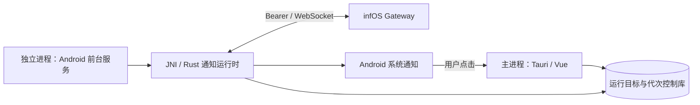

# infOS 远程客户端技术文档

PeroperoChat 作为用户所选 infOS 实例的客户端。LLM、工具执行、上下文编译、记忆检索、任务和提醒调度由该实例负责；本机负责连接、受限缓存、媒体呈现、输入与文件传输、原生通知及设备交互。本文合并自双模式规划、逻辑层实装、远程 UI、管理接入、文件说明、安卓远程通知与对话实装等文档（原始文件归档于 `docs/archived/`）。

> 边界声明：接口存在不代表 Android 原生桥接、真实 infOS 或移动端用户流程已完成验收；真机与真实服务端联调状态见 `BUILD_AND_RELEASE.md` 的版本记录。所有子应用、系统任意 HTTP 代理、内置浏览器不在范围内。

## 1. 双模式定位与运行控制

### 1.1 模式定位

| | 独立模式 | infOS 客户端模式 |
| --- | --- | --- |
| 权威 | 业务全部在本地 Rust | 聊天、任务与记忆以服务端为准 |
| 数据 | 本机 SQLite 与 TDB，不向 infOS 上传 | 每个连接一个独立分区 |
| 同名角色 | 两种模式中是不同数据归属，不因 `agentId` 相同而共用状态 | 同左 |

关键约束：**同一安装实例最多只有一套业务运行体系有效**——允许切换过程中暂时零套运行，不允许两套短暂并行。

关闭、断线与切换的含义：远程断线仍为远程模式（显示离线），不自动启用独立模式；切换远程实例是一次完整的运行目标切换，旧实例请求、缓存投影、输入凭据和回调失效；已被 infOS 接受的执行继续由服务端负责，本机断开传输不等于服务端回滚。

### 1.2 运行控制库

控制文件位于应用私有目录 `data/control/runtime.sqlite`，投影字段：

```text
schemaVersion / revision / installationId / runtimeOwnerId
selectedTarget / activeTarget / activationEpoch
phase / switchId / lastError
```

目标格式为 `{ mode: 'standalone' }` 或 `{ mode: 'remote', profileId }`；活动令牌为 `{ installationId, target, epoch }`。

- 原生控制库是唯一权威，前端/localStorage 的副本不能单独授予执行权。每个请求、事件、回调、后台任务和通知动作携带当前运行令牌。
- `mode_switch` 串行执行：先持久关闭运行门并递增代次，再通知前端、停止旧本地请求、断开远程观察连接、等待本地租约退出、受限取消清理、撤销系统登记，最后开放新目标。失败进入 `recovery_required`，活动目标为空，不自动启用另一模式。
- 本地控制、JNI、桌面提醒通知及最终数据库提交使用同一控制 SQLite 的 `BEGIN IMMEDIATE` 短事务；控制事务先于业务数据库锁获取。网络与原生插件等待不持有控制事务。
- 启动先递增代次并关闭门；只有选中独立目标时才初始化独立角色及业务存储。另一应用进程接管后，旧进程因所有权不符失去业务与切换权限。
- 不使用墙上时钟判断新旧；WebSocket 连接代次、Surface generation、Input Seat epoch 与应用模式代次互不混用。

### 1.3 数据、凭据与缓存隔离

```text
应用私有数据目录/
  data/control/runtime.sqlite             模式控制与切换恢复，不保存业务正文
  data/peropero.db                        独立模式专用
  data/diary/...                          独立模式 TDB
  data/remote/{profileId}/client.sqlite   指定远程身份的投影缓存与传输状态
  data/remote/{profileId}/assets/...      该范围内的媒体与临时文件
```

- 连接配置不可原位改变地址或实例身份；新连接产生新 `profileId`，相同服务端不自动合并分区。允许原连接重新授权：核对同一 `serverId` 后原子替换凭据指针，原分区的草稿、阅读位置与请求墓碑保留。
- 凭据平台为 Windows DPAPI、Android Keystore、iOS Keychain，不降级为明文；凭据不进入 Vue Store、localStorage 或业务备份。Android 云备份排除控制库、远程缓存、远程加密凭据与提醒系统登记缓存。
- 投影缓存最多 64 个键、正文总计 32 MiB；单份超过 8 MiB 时跳过离线缓存，不阻断在线阅读。对话、队列与任务投影使用独立的 64 MiB 额度。历史消息默认每页 24 条，超出普通页预算时自动减半重读。
- 写请求先登记不含客户端请求 ID 的内容指纹与恢复上下文；相同身份不能换内容，相同内容存在未决记录时也拒绝用新身份重复发送。重启／切换后，旧代次遗留的 `sending` 转为 `unknown`，绝不自动重放。
- 原生错误携带可选 `outcome`（`not_sent` / `rejected` / `failed` / `unknown`）：只有明确连接失败或发送前错误才可判断未发送；超时、异常响应、观察断开保留未知状态。
- `remote_reconcile_request` 只在已观察到持久 messageId、服务端权威投影确认相同会话／角色／消息时终结未知聊天；`remote_review_request` 供 UI 显式核对，需要请求指纹与非空核对说明，只记录用户已核对，不伪造服务端结果。

## 2. IPC 与前端服务

| 原生命令 | 调用方与含义 |
| --- | --- |
| `mode_snapshot`、`mode_switch` | `src/stores/mode.js`；读取运行权威、提交目标切换 |
| 现有独立命令 + 必填 `modeToken` | `src/services/localChat.js`；调用前后核对身份 |
| `remote_profiles`、`remote_save_profile`、`remote_delete_profile` | 连接配置管理；不返回凭据；当前选中配置不能删除 |
| `remote_query` | 受限的主体只读目录；可显式要求只读当前分区缓存 |
| `remote_action` | 受限写意图，每次携带稳定 `requestId` |
| `remote_chat` | 以持久客户端 UUID 提交服务端消息队列 |
| `remote_connect`、`remote_subscribe` | Gateway 身份握手与主体流订阅，原生负责重连 |
| `remote_surface_input` | 根据服务端请求确定角色，获取输入席位并提交审批／回答 |
| `remote_pending_requests` | 查询当前分区尚待核对的写请求 |
| `remote_upload`、`remote_resource` | 原生鉴权附件上传、头像／附件／带版本工作区资源读取 |
| `remote_ui_read`、`remote_ui_write` | 仅接受 Home、Session、Character 三类有限作用域 |
| `remote_manage` | 管理与工作台转发（见第 7 节） |
| `remote_notifications`、`remote_ack_notification` | 离线读取持久通知、显式已读回执 |

远程命令必须携带当前 `token`，响应与事件携带 `modeToken`，前端再次过滤旧异步结果。运行控制的 `revision` 用于拒绝晚到的旧模式投影，不能与 Surface revision 或 Input Seat epoch 混用。

### 2.1 连接与认证

- 认证方式：`pair` 使用一次性配对码，`login` 使用管理凭据兑换设备会话，`bearer` 为显式兼容模式。表单默认配对，不自动降级或重放配对请求。
- 配对链接仅接受 HTTP(S) 的 `/#/app?pair=<10 位十六进制>` 格式，拒绝附带用户信息、重复参数和回环地址；明文 HTTP 的同意不会从二维码继承。扫码使用 Tauri 原生 barcode-scanner（Rust 与前端锁定 2.4.6 版本），配对码不写入日志或 Web 存储。
- Rust 从 `Set-Cookie` 提取 `infos_device`，核对 `/api/client-access/status` 与稳定实例身份；设备令牌只进入原生系统保护存储，Cookie 不交给 WebView。未勾选「保持登录 30 天」时授权绑定本次进程所有者，重启后拒绝复用。
- 使用标准 TLS 验证，不跟随 HTTP 重定向；地址中不接受用户名、密码、查询参数与片段。每次业务传输前重新核对保存的 `serverId`；认证失败、实例改变、协议不兼容时拒绝操作。
- 凭据过期、服务端撤销、HTTP 401 或带授权失效原因的 WS 关闭会停止自动重连，保留远程目标；`remote_logout_device` 明确注销设备会话，不删除远程业务与本机阅读记录。

### 2.2 Gateway 与恢复

- WS 升级通过 Bearer 鉴权，`hello` 不重复发送凭据。Gateway 按流记录本次运行的 sequence，重订阅传回真实游标并消费补发事件，按事件身份去重；事件缺口、保留窗口过期或服务端序号回退触发权威快照刷新。游标不跨模式或连接复用。
- 断线重连采用带随机抖动的指数退避；认证／身份／协议错误暂停自动重连。恢复订阅仅刷新读模型，不重新发送写操作。
- 缓存查询在发起时取得持久化读票据，只有该键最新票据能写缓存；网络不可用时允许读取明确标识为过期的缓存，认证或实例身份变化不触发此兜底。
- 输入席位按交互请求真实角色获取；另一客户端抢先回答、席位失效或 Surface generation 改变时由服务端拒绝。输入提交在 Rust 串行化；业务提交仅在服务端明确返回席位缺失／过期／身份不匹配且尚无副作用时恢复一次。

## 3. 界面结构

入口：独立模式房间菜单的「infOS 客户端」或设置的「运行模式与远程连接」。底栏五栏：首页、会话、任务、资料、管理；通知与审批从页头铃铛或首页入口进入。启动保留上次会话恢复，优先从当前远程分区的 Home 记录恢复角色。

| 功能 | 实际接入 |
| --- | --- |
| 首页 | 当前实例、连接状态、角色 CG 或头像、上次会话、服务端任务、当前会话工作区文件、通知入口 |
| 会话 | Surface/SSE 投影、历史分页、阅读位置恢复、原生草稿、附件上传、发送和停止 |
| 极简／聊天／工作切换 | `interaction_mode` 受限 Rust 意图，成功后重新读取会话权威数据 |
| 执行和审批 | 工具／思考折叠、任务投影、审批、提问与回答、任务控制 |
| 任务 | 状态过滤、分页、新建远程任务；提交结果不明确时禁止直接重复派发 |
| 资料 | 文件分类、版本描述读取、独立的记忆和文档检索、分页与来源详情 |
| 管理与工作台 | 见第 7 节 |
| 通知 | 设备待阅通知、标为已读、待审批、问题、待核对请求 |

模式切换使用内联 SVG＋CSS 过渡动画（星笺、缎带、月晷），首次绘制后至少展示 2 秒，原生交接完成后淡出；普通断线重连不弹全屏动画。远程工作区用 `restoringView` 标识首次恢复；普通网络重连不触发全屏页。

### 3.1 主题与本机外观

- `remote-theme.css` 限定在 `.remote-themed` 容器；主题不通过独立模式角色 ID 或独立 Store 推导。
- 显示偏好：标准浅色、暗色、跟随系统；八组配色；减少动效。持久化在连接分区 `client.sqlite`：连接级 `{ kind: 'appearance' }` 与角色级 `{ kind: 'character', agentId }`，均不写入 localStorage。
- 角色样式包：JSON 导入，`schemaVersion: 1`，字段含 `lightAccent`、`darkAccent`、`secondary`、`bubble`（`standard/ribbon/soft`）、`decoration`（`standard/ribbon/constellation/none`）；文件上限 32 KiB，Rust 校验枚举，拒绝任意 CSS／脚本／资源 URL。
- 本机 CG 支持 PNG、JPEG、WebP，上限 2 MiB，按角色保存；CG 与样式属于本机展示偏好，不改写服务端、不上传、不与其他客户端同步。
- `RemoteIcon.vue` 仅渲染 `remoteArtwork.js` 内受信任的矢量常量，不接受远程 SVG 源码。

## 4. 对话渲染

- `RemoteRichText` 持有每个正文节点的增量分段器：稳定块交给 `RemoteRichBlock`，活跃尾部使用 `RemoteStreamText` 追加；不为每次正文增量整段替换 Markdown DOM。停止或失败后，未闭合围栏、公式、HTML 保留原文。
- 稳定块支持 Markdown、代码面板（highlight.js 按需高亮）、公式（KaTeX）、Mermaid（严格模式＋二次净化）、HTML／SVG 和独立资源引用。表格固定首列并局部横滑；解析失败不阻断其他块。
- HTML 正文使用独立无同源 iframe 与 CSP，自包含预览不能读取网络或应用原生桥；文件 HTML 通过原生层申请 infOS 短期票据（`/api/attachments/browser-preview`），前端不接收设备凭据。隐藏或离开可见区后卸载 iframe。
- 工具轨迹：按同一 Surface 内唯一的 `callId` 合并调用与返回；NIT 内部工具按 `parentCallId` 收纳到 `run_script` 父卡，子调用独立折叠。工具展示名称优先服务端 `display`，离线时使用 97 项官方工具兜底（仅展示，不代表已获执行授权）。参数和结果默认渲染前 6000 字符。
- 依赖固定版本：`highlight.js@11.11.1`、`katex@0.18.4`、`mermaid@11.16.1`。

## 5. 文件访问、预览与保存

入口：会话消息附件、资料页工作区文件、管理工作台。私有文件读取和保存共用 `Resource` 白名单与 Rust 原生鉴权，不向页面提供服务端凭据。相关 Rust 转发：`remote_resolve_resource` → `/api/attachments/resolve-reference`、`Resource::Reference` → `/api/attachments/reference-content`、`remote_html_preview` → `/api/attachments/browser-preview`。

### 5.1 保存

- `remote_download_resource` 原生 HTTP 流逐块写入专用临时文件；单任务上限 2 GiB，同时允许一个下载任务，显示进度、可取消。
- 下载空闲超时 45 秒，总请求超时 30 分钟；已知长度在接收前后校验。没有断点续传。网络失败、取消、长度不符不显示成功，不自动重试或覆盖现有文件。
- Android 使用系统文档创建选择器，不申请整盘存储权限；Windows 保存到下载目录并加唯一前缀；iOS 保存到应用「文稿/infOS导出」。

### 5.2 预览

| 格式 | 显示方式与限制 |
| --- | --- |
| 图片／GIF、音频、视频 | 消息内查看与放大；小图片自动读取上限 8 MiB；完整预览上限 100 MiB，按原生 Range 分段拼接 Blob |
| 文本、代码、JSON、XML | UTF-8 源码预览，完整面板最多前 256 KiB，小窗最多前 64 KiB |
| MD | 小窗正文片段，展开后富文本阅读 |
| HTML | 小窗隔离预览；完整面板优先 infOS 短期票据；页面不具有同源或原生桥权限 |
| SVG | 隔离 iframe 预览与源码切换；截断内容只显示源码 |
| PDF | 本地 PDF.js，逐页画布；文件最大 512 MiB，每次只绘制一页；不提供脚本、活动表单执行 |
| DOCX / DOC | 正文文字速览；DOC 在 Worker 内提取未加密的 Word 97–2003 正文片段，不执行宏 |
| XLSX / CSV | 工作表及缓存单元格值；不计算公式，每表最多 200 行、30 列 |
| PPTX | 各页文字速览 |
| ZIP | 目录与条目大小，最多 600 项，不解压 |
| ODT/ODS/ODP、EPUB、RTF | 文本内容速览 |
| DOCM/XLSM/PPTM | 只读取正文 XML；宏不载入不执行 |
| 其他（RAR/7z、旧版 XLS 等） | 保留元数据与保存原件入口 |

Office 与 ZIP 输入上限 8 MiB，解包在独立 Worker 中执行；XML 拒绝 DTD/实体声明。文件预览任务最多并发两个；离开可见区后停止播放器、卸载 PDF／HTML 预览。

## 6. 安卓远程后台接收

独立原生进程接收 infOS 通知，不依赖 Google 服务；不包含厂商推送、FCM、UnifiedPush 或 iOS APNs，默认关闭。



- `RemoteNotificationService` 运行在 `:remote_notifications` 进程，不创建 Activity、WebView 或本地 Agent；Rust 接收器使用当前线程 Tokio 运行时，不依赖 Tauri `AppHandle`。
- Android 14+ 声明 `specialUse` 前台服务类型；接收进程通过 Android Keystore 解密凭据（密文位于 `noBackupFilesDir/remote-credentials/` 的原子文件，旧 SharedPreferences 密文迁移）。
- 协议：`GET /api/distributed/identity` 核对 `serverId` → 读取分区 `preferences.principal`（首次通过 `/api/agents` 发现角色）→ Bearer 连接 `/ws/gateway` → 协议版本 1 `hello`（节点身份 `ppc-notifier-{installationId}-{profileId}`，不申请输入席位、不提交任何写操作）→ 只处理 `push / durable_notification`。
- 心跳每 15 秒，45 秒无入站活动则重连；认证失效、实例变化、协议不兼容持久阻止自动重试。
- 每两秒核对持久运行目标、代次、开关和凭据期限；每次通知落盘、显示及点击也校验运行门，切换期间拒绝旧回调。
- 通知缓存到当前分区 `notifications` 表（最近 256 条，展示正文限 4096 字符）；`notification_receipts` 分开保存系统展示版本与明确已读版本。只有用户明确标为已读才发送 `gateway.notifications.ack`。
- 通知点击打开远程收件箱并定位记录，不自动切换角色、实例或模式；点击在 Tauri 冷启动更新代次前核验。

## 7. 管理与工作台

入口为远程底栏「管理」；会话页操作菜单可直接打开会话设置和工作台。`remote/management.rs` 按固定操作名映射方法、路径与查询条件，复用原生凭据、实例身份核验和运行代次校验；不提供任意 HTTP 代理。

| 分组 | 功能 |
| --- | --- |
| 角色 | 创建、人设编辑、互动台词、工具/技能能力矩阵、启停、头像上传、角色包导出、删除与重载 |
| 模型 | 服务商连接、模型发现、参数、备用模型顺序、主模型/任务模型/角色模型指派 |
| 提示词 | 框架与区块编辑、草稿校验/保存、编译预览、发布与版本恢复、JSON 与酒馆预设导入/导出 |
| 其他配置 | 用户资料、配置项读写、MCP 服务、技能、工具目录、外部消息路由 |
| 会话 | 会话模型与思考强度、执行方式、工具开关、Token 预算、暂停/继续/追加指令、按修订编辑消息、回滚并重新生成 |
| 资料 | 记忆归档/恢复/删除、事实撤回、文档导入、检索与重建索引 |
| 工作台 | 会话绑定文件树、文本编辑、终端（创建/选择/输入/中断/终止/归档/固定） |
| 据点 | 设施和房间创建、成员移动、群聊 Surface 与消息发送、提及、管家设置 |
| 任务与其他 | 任务派发与状态操作、定时任务、主动陪伴策略、用量统计、设备接入、数据重置 |

职责与隔离：

- `remote_manage` 读取直接返回，不进入投影缓存；写入登记只保存操作名、对象标识与请求指纹，不保存配置正文或回执中的密钥/配对码。
- 配置、提示词与资料的业务校验、权限、发布、持久化由 infOS 处理；手机只保留编辑态，离开页面释放。写请求不自动重试，未知结果从核对抽屉处理。
- 文件保存发送 `expectedHash`，消息编辑发送 `expectedRevision`；服务端冲突不由客户端强行覆盖。
- 常规管理正文限制 1 MiB，上传和普通响应 8 MiB；文本编辑一次最多读取 128000 字符。终端是服务端游标轮询的有界文本输出，不是完整 ANSI/TUI 终端。
- 群聊读取最近 100 条消息；语音支持主动录音、上传识别和朗读，未实现后台常驻监听。

二期（日常与据点）补充分层：管理首页常用设置图块、模型与服务商分开、主动陪伴三模式卡、会话单聊群聊并列、用量与运行真实接口；新增 `src/i18n/remote.js` 三语词库（简中/繁中/英文），跟随 `user.language` 和 Gateway 语言变更，展示层不翻译角色名、模型名或请求参数。

## 8. 待完成事项（TODO 汇总）

- 接入真实 infOS 完成会话、审批、多客户端席位、任务和据点闭环联调；与 infOS 明确写请求幂等、接受状态查询、未知请求核对及版本／能力合同。
- 补齐通知的业务对象跳转与完整分页；多角色设备订阅和通知合同待 infOS 配合。
- 补齐未纳入目录的次级模型／资料管理与语音范围。
- Android 真机验证：Kotlin 桥接、Keystore、发布压缩、系统备份排除、切换撤销与冷启动展示竞态；iOS 凭据分支与扫码真机验收。
- 对远程 UI、模式过渡与恢复流程进行已获授权的运行与真机验收。
